# Benutzerhandbuch für Planer

Dieses Handbuch richtet sich an Koordinatoren und Planer der Versammlung – also an
alle, die Zuteilungen vornehmen, Personen und Gruppen verwalten oder die
Versammlungseinstellungen pflegen.

> Die Grundfunktionen (Anmelden, Programm ansehen, eigene Aufgaben bestätigen,
> Abwesenheiten, Profil) sind im [**Handbuch für Verkündiger**](verkuendiger.md)
> beschrieben und gelten für dich genauso. Dieses Handbuch ergänzt die
> **Planer‑Funktionen**.

> **Löschen fragt immer nach.** Der erste Tipp auf **✕** (oder **Entfernen**)
> zeigt **Wirklich löschen?** – bei dem, was nur herausgenommen wird, etwa eine
> Person von ihrem Platz, **Wirklich entfernen?**. Erst der zweite Tipp führt
> es aus; ein Tipp daneben bricht ab. So geht nichts durch einen Fehltipp
> verloren, und niemand bekommt versehentlich die Nachricht, dass seine
> Zuteilung zurückgezogen ist.

---

## Inhalt

1. [Dashboard für Planer](#1-dashboard-für-planer)
2. [Planen: Zuteilungen vornehmen](#2-planen-zuteilungen-vornehmen)
3. [Automatisch zuteilen & leeren](#3-automatisch-zuteilen--leeren)
   – [Vortragsplan übernehmen](#vortragsplan-übernehmen)
4. [Konflikte und offene Zuteilungen](#4-konflikte-und-offene-zuteilungen)
   – [Die Zusagen der Woche](#die-zusagen-der-woche)
   – [Auswertung](#4a-auswertung-wie-die-zuteilungen-verteilt-sind)
5. [Treffpunkte planen](#5-treffpunkte-planen)
   – [Weitere Pläne](#5a-weitere-pläne)
6. [Personen verwalten](#6-personen-verwalten)
7. [Einstellungen](#7-einstellungen)
   – [Zusätzliche Klasse](#7a-zusätzliche-klasse)
8. [Programm holen](#8-programm-holen)
9. [Pläne drucken](#9-pläne-drucken)
10. [Ohne Internet (offline)](#10-ohne-internet-offline)
11. [Was die App wie lange aufbewahrt](#11-was-die-app-wie-lange-aufbewahrt)

---

## 1. Dashboard für Planer

Als Planer siehst du auf der Startseite neben deiner persönlichen Übersicht –
deiner nächsten Aufgabe und den Aufgaben danach, wie bei jedem Verkündiger – die
**Planung**: was in den kommenden Wochen noch zu tun ist. Am Tablet und am
Computer steht sie in einer eigenen Spalte daneben, am Handy darunter, dort an
der Stelle von „Diese Woche in der Versammlung".

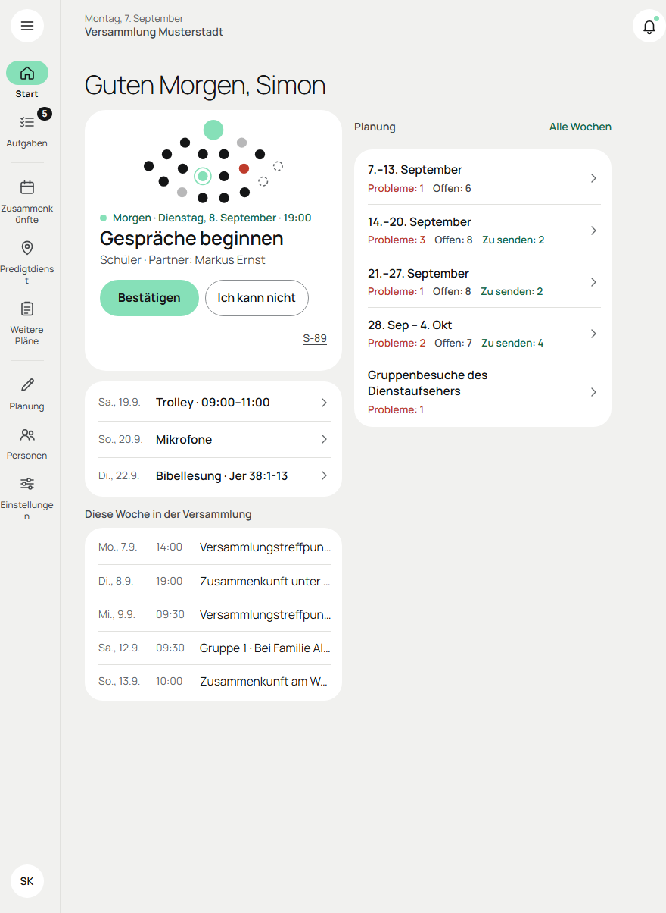

- **Eine Zeile je Woche, in der etwas zu tun ist** – ab der laufenden Woche,
  höchstens vier Wochen voraus. Fertig geplante und gesendete Wochen erscheinen
  nicht. Auch eine Kongresswoche erscheint, wenn dort ein Treffpunkt noch einen
  Leiter braucht.
- Die Zeile nennt, was ansteht – mit denselben Wörtern wie die Wochen unter
  **Planung** (Abschnitt 8); was dahintersteht, zeigt beim **Planen** die Liste
  **Zu klären** (Abschnitt 4):
  - **Probleme** – mögliche Konflikte, z. B. jemand ist eingeteilt, aber
    abwesend, und Bereiche, für die an dem Tag zu wenige Leute da sind,
  - **Offen** – noch unbesetzte Plätze, auch Treffpunkte ohne Leiter,
  - **Zu senden** – Zuteilungen, von denen die Eingeteilten noch nichts wissen.

  Die Zahlen gelten für die **ganze Woche**; beim Planen verteilen sie sich auf
  die Reiter. Ein Tipp auf die Zeile öffnet das **Planen** genau dieser Woche –
  auf dem Reiter, in dem etwas zu tun ist (ist nur noch ein Treffpunkt-Leiter
  zu benachrichtigen, im Predigtdienst).
- **Was vorbei ist, zählt nicht mehr.** Am Donnerstag nennt die Karte nur noch,
  was am Wochenende offen ist; den Dienstag kann niemand mehr besetzen. Die
  Karte merkt den Tageswechsel auch, wenn die App über Nacht offen war.
- Reichen die geladenen Programme **weniger als drei Wochen** voraus, steht in
  der Karte **„Geladen bis …"** mit dem Knopf **Holen** – derselbe wie bei den
  Wochen (Abschnitt 8). Der Hinweis verschwindet, sobald der Vorrat wieder
  reicht.
- **Alle Wochen** über der Karte führt zu allen Wochen, auch den fertigen
  (Abschnitt 8).
- **Gruppenbesuche des Dienstaufsehers** mit möglichen Konflikten stehen als
  eigene Zeile darunter, auch wenn der Besuch Monate voraus liegt; ein Tipp
  führt zu den Gruppenbesuchen (Abschnitt 5).
- Ist nichts zu tun, schrumpft die Karte auf eine Zeile **„Alles zugeteilt"** –
  darunter der Zeitraum, für den das gilt. Wochen dahinter hat sie nicht
  angesehen.
- Das Menü an der Seite: oben **Start** und **Meine Aufgaben**, darunter unter
  **Versammlung** die **Zusammenkünfte**, der **Predigtdienst** und die
  **Weiteren Pläne**, zuletzt unter **Planen und verwalten** die **Planung**,
  die **Auswertung** (Abschnitt 4a) und – nur für Admins – **Personen** und
  **Einstellungen**. Dein **Profil** erreichst du über deinen Namen ganz unten.
- **Ansehen oder Planen.** Die Bereiche im Menü öffnen immer zum Ansehen: so,
  wie es alle sehen. Neben dem Titel steht **Planen** – damit kommst du zu den
  Zuteilungen. Beim Planen steht dort **Fertig**, am Handy oben dazu ein Kreuz;
  beides führt zurück zum Ansehen, ebenso die Zurück‑Taste des Handys.
- **Planung** im Menü fragt zuerst, was du planen willst: **Zusammenkünfte**,
  **Predigtdienst** oder **Weitere Pläne** – je eine Karte, bei den
  Zusammenkünften mit den Problemen und dem, was zu senden ist, über alle
  Wochen. **Zusammenkünfte** führt am Handy und am Tablet zu allen Wochen, am
  breiten Bildschirm gleich in den Plan, mit den Wochen links daneben
  (Abschnitt 8). So geplant, steht statt **Fertig** ein Pfeil **Zurück** vor
  dem Titel (am Handy oben links); er führt eine Ebene hinauf – aus einer Woche
  zu den Wochen, von dort zur Auswahl. Die Zurück‑Taste des Handys geht
  denselben Weg.

  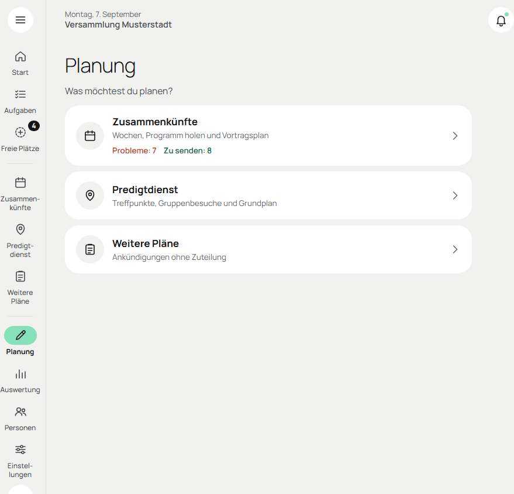
- **Gruppenaufseher** planen nur den Predigtdienst ihrer Gruppe: Sie sehen
  **Planen** nur dort, unter **Planen und verwalten** nur die **Planung** – sie
  führt ohne Auswahl gleich zu den Treffpunkten ihrer Gruppe –, und die
  Startseite wie Verkündiger, ohne Planungs‑Karte.

### Wer darf was: Planer und Admin

Es gibt zwei Rechte, die du bei einer Person in der Karte **Rechte** vergibst:
**Darf planen** (der Planer) und **Admin**. Der Planer plant alles: Er holt
das Programm, richtet die Wochen ein, teilt zu und sendet, und er pflegt
Treffpunkte, Gruppenbesuche und Weitere Pläne. Der Admin verwaltet zusätzlich
Personen und Einstellungen. Ein Admin hat das Planer-Recht ohnehin – bei ihm
steht der Schalter **Darf planen** an und lässt sich nicht umlegen.

| | Verkündiger | Gruppenaufseher und Gehilfe | Planer | Admin |
| --- | --- | --- | --- | --- |
| Programmpunkte, Hilfsdienste, Ratgeber zuteilen | – | – | ✓ | ✓ |
| Vortragsthema, Lieder, Partner am Schülerteil | – | – | ✓ | ✓ |
| Vortragsplan aus dem Planungsprogramm übernehmen | – | – | ✓ | ✓ |
| Treffpunkt-Leiter zuteilen | – | seine Gruppe | alle | alle |
| Treffpunkte ändern: Zeit, Ort, hinzufügen, entfernen, Grundplan | – | seine Gruppe | alle | alle |
| Sich für den Trolley eintragen (mit dem Aufgabenbereich **Trolley**) | ✓ | ✓ | ✓ | ✓ |
| Gruppenbesuche planen: anlegen, verlegen, Besucher wechseln | – | – | ✓ | ✓ |
| Weitere Pläne: anlegen, einstellen, veröffentlichen, Gruppen verteilen | – | – | ✓ | ✓ |
| **Plan senden** | – | Treffpunkte seiner Gruppe | ✓ | ✓ |
| Programm holen, **Woche einrichten** (Anlass, Sonderwoche, Termine), Punkte unter „Unser Leben als Christ" anlegen, umbenennen, verschieben, Minuten | – | – | ✓ | ✓ |
| **Auswertung** der Zuteilungen ansehen | – | – | ✓ | ✓ |
| Die App mit anderen Rechten ansehen (befristet, im Profil) | – | – | – | ✓ |
| Personen, Abwesenheiten anderer, Einstellungen mit Trolleys, Mitglieder, Anmelde-Links | – | – | – | ✓ |

**Gruppenaufseher und Gehilfe** ist, wen du im Blatt seiner
Predigtdienstgruppe einträgst; dort stehen nur ihre Mitglieder zur Wahl (siehe
[Gruppen und Trolleys](#gruppen-und-trolleys)). Jeder gehört genau einer Gruppe an, also leitet auch
jeder höchstens eine – „seine Gruppe" in der Tabelle ist die, der er
angehört.

Die Meldungen an die Planer – eine **Verhinderung**, **Ersatz gefunden**,
**unbestätigte Zuteilungen** – bekommen Admins und Planer: Wer zuteilt, sucht
auch den Ersatz. Personen und Einstellungen zeigt die App einem Planer gar
nicht erst an; die Datenbank weist sie zusätzlich ab. Bis zum 15. Oktober 2026
teilte der Planer nur zu – die Pläne selbst änderte der Admin.

Für den Trolley trägt sich jeder selbst ein, auf Wunsch gleich mit einem
Partner; zuteilen kann dort niemand (siehe [Trolleys](#trolleys)).

Unter dem eigenen Namen unten in der Seitenleiste (am Handy im Menü) steht,
was jemand darf: **Admin**, **Planer**, **Gruppenaufseher** bzw. **Gehilfe**
einer Gruppe – sonst **Verkündiger**.

### Die App mit anderen Rechten ansehen (befristet)

Solange die App erprobt wird, kann ein **Admin** sie so ansehen, wie ein
Planer, ein Gruppenaufseher oder ein Verkündiger sie sieht: im **Profil** unter
**Ansicht zum Testen** → **Ansehen als**. Als Gruppenaufseher siehst du deine
eigene Gruppe – ihr Name steht an der Stufe; wer keiner Gruppe angehört,
bekommt den Gruppenaufseher nicht angeboten. Solange die Ansicht gilt, steht
oben die Leiste **Ansicht als …** – **Beenden** führt zurück zum eigenen Recht,
ebenso das Neuladen der App.

- Die Ansicht zeigt Menü, Bildschirme, Knöpfe und Mitteilungen der Stufe, und
  unter deinem Namen steht die Stufe. Fällt der Bildschirm weg, auf dem du
  gerade bist, geht es zum Start.
- **Was du in der Ansicht tust, ist echt** und geschieht mit deinen eigenen
  Rechten. Die Datenbank kennt nur sie: Was die App einem Verkündiger gar nicht
  schicken würde, hat sie bei dir trotzdem geladen.
- Planer und Verkündiger sehen die Karte nicht. Nach den Tests kommt sie wieder
  heraus.

---

## 2. Planen: Zuteilungen vornehmen

Unter **Zusammenkünfte** schaltest du oben rechts auf **Planen** und teilst die
Aufgaben und Hilfsdienste einer Woche zu. Die Karten der beiden Tage (mit
Datum und Uhrzeit) wechseln zwischen der **Zusammenkunft unter der Woche** und
**am Wochenende**; daneben steht die Karte mit dem Zeichen (drei Regler):
**Woche einrichten** (Abschnitt 3). Die Zusammenkünfte für den Predigtdienst sind ein eigenes
Thema im Menü (Abschnitt 5). Mit ‹ › wählst du die Woche – auf Handy und
Tablet geht auch seitwärts wischen.

Beim Öffnen stehen Planen und Ansehen auf der **nächsten** Zusammenkunft: am
Samstag also auf dem Wochenende, am Sonntagabend schon auf der Wochenmitte der
kommenden Woche. Entfällt eine (Kongress, Gedächtnismahl), wird sie
übersprungen. Sobald du selbst eine Woche oder einen Reiter wählst, bleibt es
dabei – du wirst beim Hin- und Herwechseln nicht wieder umgesetzt.

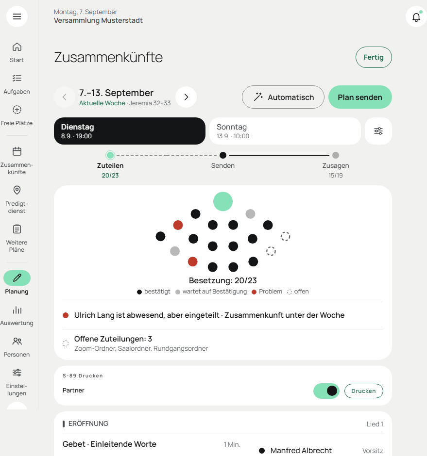

Oben steht der **Stand der Woche**: drei Schritte auf einer Linie –
**Zuteilen** (besetzte von allen Plätzen der Zusammenkunft, etwa „11/14"),
**Senden** (wie viele Zuteilungen der ganzen Woche noch niemand kennt,
„Neu: 5") und **Zusagen** (bestätigt von allen, die etwas zu bestätigen haben).
Hervorgehoben ist der Schritt, der gerade dran ist: erst wird besetzt, dann
gesendet, dann kommen die Zusagen. Ein Tipp auf **Zusagen** öffnet die
[Zusagen der Woche](#die-zusagen-der-woche). Darunter die Karte **Besetzung**: der Saal,
dessen Plätze die Lage der Zuteilungen zeigen, die Zahl „Besetzung: 11/14", die
Legende und darunter, was **zu klären** ist (Abschnitt 4). Fällt die
Zusammenkunft aus, stehen beide nicht da – es gibt nichts zu besetzen.

Unter der Karte **Besetzung** steht **S‑89 DRUCKEN**: ein Tipp auf **Drucken**
legt alle Schülerzettel der offenen Woche als DIN‑A4‑Bogen an, **sechs je
Blatt**. Der Schalter **Gesprächspartner/in** bestimmt, ob der Zettel eines
Gesprächs **zweimal** kommt – einer für den Schüler, einer für die Partnerin
oder den Partner. Beide tragen dieselben Angaben, so wie das Formular es
vorsieht. Die Zettel der Zusätzlichen Klasse sind dabei und tragen ihren Raum.

- **Auf einen Platz tippen**, um ihn zu besetzen oder umzuteilen. Es öffnet
  sich das Blatt **Zuteilen**: oben der Abschnitt, der Punkt mit Nummer, Tag und
  Dauer. Ist der Platz besetzt, steht darunter, wer ihn hat und wie es steht —
  derselbe Punkt wie im Plan, dazu „wartet auf Bestätigung", „bestätigt" oder
  rot der Grund, etwa „abwesend 7.–11. September". Dort stehen auch
  **Entfernen** (mit Rückfrage) und bei Schulungsaufgaben **S‑89 anzeigen**.
- Unter **Wer übernimmt?** suchst du nach Namen — auch ohne Umlaute („kruger")
  und in beliebiger Reihenfolge („krüger s"). Darunter stehen alle, die den
  **Aufgabenbereich** haben („Mit diesem Aufgabenbereich: 12"). Ganz oben steht
  der **Vorschlag**: die Person, die **Automatisch** hier nehmen würde; die
  übrigen folgen in derselben Reihenfolge.
- Jede Zeile sagt, was für oder gegen die Person spricht: **rot** abwesend mit
  dem Zeitraum (antippen geht nicht, die App sagt warum), **„An diesem Tag
  schon: Mikrofone"** bei einer Doppelbelegung (das darfst du trotzdem), sonst
  **„zuletzt vor 6 Wochen"** in diesem Aufgabenbereich oder „länger nicht dran"
  und, was am anderen Tag der Woche schon ansteht („So Saalordner"). Rechts
  zeigen **fünf Punkte** die Auslastung: so viele voll, wie die Person in den
  fünf Wochen um diese herum Aufgaben hat. Abwesende stehen am Ende.
- **Am Computer** (breites Fenster) öffnet sich kein Blatt: Das Zuteilen steht
  als **Spalte rechts neben dem Programm**, das sichtbar bleibt. Ein Klick auf
  einen Platz zeigt ihn dort und hebt ihn im Plan hervor; der Cursor steht
  gleich in der Suche — Namen tippen, Person anklicken, nächster Platz.
- Die Abwesenheiten kommen aus den Einträgen, die die Verkündiger selbst in
  ihrem **Profil** erfassen (**Von–Bis** als Datum). Geprüft wird der
  **Tag der jeweiligen Zusammenkunft**, nicht die Woche: wer nur übers Wochenende
  weg ist, steht unter der Woche weiterhin zur Verfügung. Bei den Treffpunkten
  zählt der Wochentag des jeweiligen Treffpunkts.
- Programmpunkte (Vorsitz, Gebet, Bibellesung, Schulungsaufgaben …) und
  **Hilfsdienste** (Mikrofone, Ton, Ordner, Reinigung …) werden getrennt geführt.
- **Jeder Platz ist eine Zeile**: vorn ein Punkt, dann der Name und die Rolle
  (Leiter, Leser, Mikrofone …). Ein offener Platz heißt **Zuteilen** – er sagt,
  was dort zu tun ist. Ab dem Tablet stehen die Plätze rechts neben ihrem
  Programmpunkt. Der Punkt zeigt, wie der Platz steht; die Legende in der Karte
  **Besetzung** nennt die vier Lagen:
  - **voll** – bestätigt, oder es gibt nichts zu bestätigen
  - **blass** – wartet auf Bestätigung; das steht auch hinter der Rolle
  - **rot** – ein Problem: abgesagt, abwesend oder an dem Tag schon
    eingeteilt. Den Grund nennt die Zeile rechts – bei einem Hilfsdienst nach
    einer Absage „Ersatz gesucht", denn dort sucht die App selbst. Hier musst
    du handeln (siehe „Wenn jemand absagt" und Abschnitt 4)
  - **gestrichelt** – offen

  Die Lage gilt dem **einzelnen Platz**, nicht der Person: Hat jemand den
  Vorsitz bestätigt, das Gebet aber noch nicht, steht ein voller neben einem
  blassen Punkt. Teilst du einen Platz um, wird sein Punkt wieder blass – die
  Zusage gehört dem, der sie gegeben hat. Wo niemand bestätigen kann
  (Gastredner, Kreisaufseher, Reinigungsgruppe, eine ausgefallene
  Zusammenkunft), ist der Platz mit dem Namen besetzt und steht voll da. Die
  vier Lagen unterscheiden sich auch in Helligkeit und Form, nicht nur im
  Farbton.

**Schülerteile im Abschnitt „Uns im Dienst verbessern"** brauchen je nach Art
ein oder zwei Personen. Gesprächsteile (Gespräche beginnen, Interesse fördern,
Menschen zu Jüngern machen) haben einen **Hauptteilnehmer** und einen
**Gesprächspartner** – beide werden getrennt zugeteilt. Vorträge/Ansprachen
haben nur einen (männlichen) Teilnehmer; für sie gibt es den eigenen Bereich
**„Schulungsaufgaben · Vorträge"** – wer Gespräche führt, hält damit nicht
automatisch auch Vorträge. Die App legt die passende Zahl beim Import
automatisch an; mit **„+ / – Gesprächspartner"** unter einem Gesprächsteil
kannst du den Partner bei Bedarf hinzufügen oder entfernen. Für den Gesprächspartner
werden nur Personen mit demselben Geschlecht vorgeschlagen – **oder
Familienangehörige** (siehe „Familie" im Personen‑Detail), die auch
geschlechtsübergreifend zusammen eingeteilt werden dürfen. Wer nur als Partner
(nicht als Gesprächsführer) eingeteilt werden soll, bekommt in den Personendaten
den Bereich **„Schulungsaufgaben Partner"**. Die automatische Zuteilung setzt
Gesprächsteile bevorzugt mit Verkündigern und Schwestern (nicht mit Ältesten/
Dienstamtgehilfen) und achtet auf gleiches Geschlecht der beiden Partner.

Beim Wochenende trägst du hier das **Vortragsthema** und die
**Anfangslied‑Nummer** ein. Den Ablauf selbst änderst du unter **Woche
einrichten › Programmpunkte bearbeiten** (Abschnitt 3, „Das Programm
bearbeiten").

---

## 3. Automatisch zuteilen & leeren

Beim Planen der Zusammenkünfte steht am Handy unten eine Leiste mit
**Automatisch** und **Plan senden**; bei großer Schrift und auf sehr schmalen
Handys stehen die beiden untereinander, **Plan senden** unten. Am Tablet und am
Computer stehen die Knöpfe rechts neben der Woche. **Automatisch** öffnet ein
Blatt:

- **Die Bereiche:** **Aufgaben im Programm** und **Hilfsdienste**, je mit ihrer
  Besetzung („Besetzung: 5/8"). Vorgewählt ist, wo am gezeigten Tag etwas offen
  ist; mit den Kästchen wählst du um.
- **Der Umfang:** **Nur Dienstag** (der Tag, den du gerade planst — bei euch
  vielleicht ein anderer) oder **Ganze Woche**, dann beide Zusammenkünfte. Eine
  ausgefallene Zusammenkunft zählt nicht mit.
- **Zuteilen** besetzt die offenen Plätze der gewählten Bereiche; die Meldung
  danach nennt, wie viele es waren.
- **Leeren** entfernt die Zuteilungen der gewählten Bereiche im gewählten
  Umfang. Es fragt erst nach („Wirklich leeren?"); wählst du danach etwas
  anderes, gilt die Frage nicht mehr. Die Reinigung rotiert über die
  Predigtdienstgruppen, die reinigen (siehe [Hilfsdienste](#hilfsdienste)).

Die Automatik wählt bevorzugt Personen mit der **geringsten Auslastung**, lässt
Abwesende aus und vergibt niemanden doppelt am selben Tag. Ausnahmen: Der
Vorsitz spricht das Anfangsgebet, liest am Wochenende den **Wachtturm** und hält
den **Vortrag des Vorsitzenden**, wo das Arbeitsheft einen nennt – diese Plätze
folgen ihm (von Hand änderbar). Leitet er das Wachtturm-Studium selbst, liest
ein anderer – den wählt die Automatik wie für jeden Platz.
Und den Leiter des Wachtturm-Studiums bestimmen **feste Rollen**, wenn dafür
welche vergeben sind – meist steht er schon seit dem Holen in der Woche (siehe
[Aufgabenbereiche](#aufgabenbereiche)). Externe Redner
(Gastredner, Kreisaufseher) bleiben offen und werden manuell eingetragen. Nach dem
Zuteilen kannst du einzelne Slots wie gewohnt noch von Hand anpassen.

Das **Schlussgebet am Wochenende** plant niemand: Es spricht der Redner, wenn
er bleibt, sonst bittet der Leiter des Wachtturm-Studiums vor Ort jemanden.
Leer steht dort „Redner oder vor Ort“ statt „Zuteilen“; die Automatik lässt
den Platz aus, er zählt nicht als offen und wird nicht als freier Platz
angeboten. Weißt du vorher, wer betet, trägst du ihn wie sonst ein – dann ist
es eine Zuteilung mit Zusage und Erinnerung.

### Woche einrichten

Was der ganzen Woche gehört, stellst du unter **Woche einrichten** ein:
beim Planen der Zusammenkünfte die Karte mit dem Zeichen (drei Regler) neben
„Dienstag" und „Sonntag". Die Seite ist eine Ebene unter dem Plan – oben führt
der Pfeil zurück, ebenso die Zurück-Taste. Untereinander stehen vier Karten:

| Karte | Was du dort einstellst |
| --- | --- |
| **Anlass der Woche** | Normale Woche, Besuch des Kreisaufsehers, Kongress oder Gedächtnismahl – je mit dem, was er für die Woche bedeutet; dazu Datum und Uhrzeit des Mahls bzw. die Tage des Kongresses |
| **Zusammenkünfte dieser Woche** | Beide Zusammenkünfte mit Tag und Uhrzeit; **Verlegen** klappt die Abweichung auf (siehe unten) |
| **Weitere Termine** | Pionierbesprechung und was sonst ansteht (siehe unten) |
| **Programm** | **Programmpunkte bearbeiten** – „Unser Leben als Christ" (siehe unten) |

### Sonderwoche: verlegen oder absagen

Manchmal weicht eine Woche ab — mehrere Versammlungen teilen sich einen Saal,
eine hat Dienstwoche, und ihr müsst euren Tag verschieben. Oder es ist
Kongress und die Zusammenkunft entfällt ganz.

Dafür steht unter **Woche einrichten › Zusammenkünfte dieser Woche** bei jeder
Zusammenkunft **Verlegen**. Die Karte gehört der ganzen Woche, nicht einer
einzelnen Zusammenkunft — deshalb stellst du dort **beide** Zusammenkünfte
ein, ohne die Karte zu wechseln. Weicht eine schon ab, steht ihr Feld offen
da, und eine ausgefallene ist durchgestrichen. Je Zusammenkunft:

| Bedienelement | Wirkung |
| --- | --- |
| **Schalter** neben dem Namen der Zusammenkunft | Aus = sie findet in dieser Woche **nicht** statt |
| **Wochentag** | Verlegt sie auf einen anderen Tag |
| **Uhrzeit** | Verlegt den Anfang |
| **Grund** | Freitext, erscheint im Hinweis — z. B. „Kongress in Nürnberg" |

Wählst du wieder den regulären Tag bzw. die reguläre Uhrzeit, ist die Verlegung
damit aufgehoben; das Feld verliert seine Hervorhebung.

**Was daran hängt.** Eine Verlegung zieht alles mit: den Termin in „Meine
Aufgaben", das S-89-Formular, die Erinnerungen und die Karten der Tage.
Fällt eine Zusammenkunft aus, hat sie keine offenen Plätze mehr, taucht in
keiner Konfliktprüfung auf, wird nicht automatisch zugeteilt, verschickt keine
Erinnerungen und zählt bei niemandem auf die Auslastung.

**Die Zuteilungen bleiben trotzdem stehen.** Nimmst du den Ausfall zurück, ist
deine Planung wieder da — es geht nichts verloren.

> Beim **Gedächtnismahl** entfällt die Zusammenkunft, die es verdrängt: die
> unter der Woche, wenn das Mahl auf Montag bis Freitag fällt, sonst die am
> Wochenende. Das stellt die App selbst ein, sobald unter **Anlass der Woche**
> das Datum des Mahls steht. Für diese Zusammenkunft gilt dann alles, was hier
> über den Ausfall steht.

### Weitere Termine der Woche

Zu einer Woche gehört manchmal mehr als die beiden Zusammenkünfte und die
Treffpunkte — eine **Pionierbesprechung**, eine **Besprechung mit
Dienstamtgehilfen und Ältesten**, was sonst ansteht.

Unter **Woche einrichten › Weitere Termine** legst du mit **+ HINZUFÜGEN**
so viele Termine an, wie du brauchst. Jeder hat vier Felder, alle bis auf den Namen freiwillig:

| Feld | Wofür |
| --- | --- |
| **Name** | Wie der Termin heißen soll — deine Worte, z. B. „Pionierbesprechung" |
| **Wochentag** | Lass ihn auf „—", solange der Tag noch nicht feststeht |
| **Uhrzeit** | |
| **Ort** | Freitext, z. B. „Königreichssaal" |

Die Termine erscheinen beim **Ansehen** über den Karten der Tage — also bei
beiden Zusammenkünften und auch im Predigtdienst, denn sie gehören zu keiner
einzelnen Zusammenkunft. **Alle sehen sie**,
und zwar nach Wochentag und Uhrzeit geordnet; Termine ohne Tag stehen hinten.

> **Ein Termin ist eine Ankündigung, keine Zuteilung.** Es gibt dazu keinen
> Bearbeiter, keine Bestätigung und keine Erinnerung — er steht einfach da.
> Wer etwas leiten soll, bekommt es als Programmpunkt oder Treffpunkt.

Name und Ort bleiben so stehen, wie du sie schreibst; sie werden **nicht**
übersetzt — es sind deine Worte, wie der Grund einer Verlegung. Nur der
Wochentag erscheint bei jedem in seiner eigenen Sprache.

### Das Programm bearbeiten

Unter **Woche einrichten › Programmpunkte bearbeiten** steht das Programm der
Zusammenkunft unter der Woche, Abschnitt für Abschnitt. Unter **Unser Leben als
Christ** öffnet ein Tipp auf einen Punkt sein Blatt; alles andere kommt aus dem
Arbeitsheft und bleibt, wie es ist.

- **Titel:** Jeder Punkt lässt sich umbenennen, auch einer aus dem Arbeitsheft —
  etwa „Örtliche Bedürfnisse" in das eigentliche Thema. Übernommen wird der
  Titel, sobald du das Feld verlässt, Enter drückst oder das Blatt schließt;
  **Esc** verwirft die Eingabe, und ein leeres Feld ändert nichts. Der neue
  Titel steht in allen Sprachen des Programms gleich. Die Punkte des
  Kreisaufsehers haben kein Titelfeld: Ihr Thema trägst du im Plan ein (siehe
  „Besuch des Kreisaufsehers").
- **Dauer:** **−** und **+** ändern sie um je eine Minute, zwischen **5 und 45
  Minuten**; an der Grenze ist der Knopf gesperrt. Die **Endzeit der
  Zusammenkunft** darunter wandert automatisch mit.
- **Nach oben / Nach unten** verschiebt den Punkt; am Rand ist der Knopf
  gesperrt.
- **Entfernen** fragt noch einmal nach („Wirklich entfernen?") — mit dem Punkt
  gehen seine Zuteilungen.

Darunter fügt **Programmpunkt einfügen** einen eigenen Punkt ein: Titel
eintragen, **Übernehmen**. Er kommt vor das Versammlungsbibelstudium und
beginnt mit 10 Minuten.

Zugeteilt wird im Plan, nicht im Blatt eines Punkts — und den Ablauf ändert man
umgekehrt nur hier, nicht im Plan.

### Besuch des Kreisaufsehers

Unter **Anlass der Woche** wählst du **Besuch des Kreisaufsehers**. Er betrifft
beide Zusammenkünfte auf einmal:

| | Was passiert |
| --- | --- |
| **Unter der Woche** | Aus dem Versammlungsbibelstudium wird der **Dienstvortrag** — 30 Minuten, ein Platz, kein Leser |
| **Wochenende** | Das Wachtturm-Studium wird auf **30 Minuten** verkürzt und braucht **keinen Leser** mehr; dahinter kommt ein **Vortrag** von 30 Minuten |

Die Endzeiten ändern sich dabei nicht.

**Das Thema** trägst du direkt am Punkt ein, hinter der Bezeichnung — wie beim
öffentlichen Vortrag.

**Die Namen trägst du selbst ein**, an jedem der drei Plätze einzeln
(Dienstvortrag, öffentlicher Vortrag, Vortrag am Wochenende). Das ist Absicht:
der Kreisaufseher bringt manchmal jemanden mit, den er schult, und die
Begleitung kann eine dieser Aufgaben übernehmen — welche, steht vorher nicht
fest. Alle drei nehmen deshalb Freitext.

Wer dort steht, bekommt **keine Erinnerung, keine Bestätigungsanfrage und keine
Anrechnung auf die Auslastung** — er gehört ja nicht zur Versammlung.

**Schaltest du wieder aus**, ist alles zurück: das Bibelstudium samt seiner
Zuteilungen, das volle Wachtturm-Studium mit Leser. Es geht nichts verloren,
falls der Besuch verschoben wird.

### Öffentlicher Vortrag: Gastredner oder eigener Redner

Der Rednerplatz am Wochenende kann beides sein, und du entscheidest es Woche für
Woche — im Zuteilungs-Blatt, ohne einen zusätzlichen Schalter:

| Was du tust | Was daraus wird |
| --- | --- |
| Name und Versammlung in die **Freitext-Felder** eintragen | Gastredner. Er bekommt keine Aufgabe, keine Erinnerung, keine Bestätigung und zählt nicht auf die Auslastung — er gehört ja nicht zu euch. |
| Eine **Person aus der Liste** antippen | Ein Bruder eurer Versammlung. Er bekommt die Aufgabe wie jede andere: Bestätigung, Erinnerung, Anrechnung auf die Auslastung. |

Beides steht im selben Blatt untereinander, jeder Weg führt also auch wieder
zurück. **Entfernen** und **Leeren** setzen den Platz auf „Gastredner" zurück —
den Redner des öffentlichen Vortrags vereinbart man, deshalb besetzt die
Automatik ihn nie von sich aus. Mit dem Gastredner geht beim Entfernen auch
seine Versammlung, ebenso, wenn du statt seiner eine Person aus der Liste
antippst.

Im Programm und im Ausdruck **Diese Woche** steht neben dem Gastredner seine
**Versammlung** statt des Worts „Gastredner" – trag sie also mit ein, wenn du
sie weißt. Übernimmst du den Vortragsplan, kommt sie aus der Datei mit. Ohne
Versammlung steht dort weiter „Gastredner".

Ein auswärtiger Redner muss dafür **nicht** als Person angelegt werden.

Die Auslastung zählt dieselben **fünf Wochen**, die im Zuteilungs-Blatt die
Punkte neben jedem Namen zeigen („Aufgaben in 5 Wochen") – die Punkte erklären
also die Reihenfolge, in der die Personen dort stehen, und der **Vorschlag**
oben ist genau, wen die Automatik nähme. Sind mehrere gleichauf — bei den Schulungsaufgaben der
Normalfall, weil es mehr Schwestern als Plätze gibt —, kommt zuerst, **wer am
längsten nicht dran war**; dafür schaut die Automatik über alle geladenen Wochen,
nicht nur über das Fenster. Aufgaben in der
Zusätzlichen Klasse zählen dabei genau wie die im Hauptsaal, der Ratgeber
ebenfalls. So kommt über die Monate jeder ähnlich oft an die Reihe, statt dass
einzelne Namen dauerhaft vorn oder hinten stehen.

Zuletzt wird noch **der Aufgabenbereich selbst** ausgeglichen: wer zuletzt das
Gespräch geführt hat, tritt beim nächsten Gesprächsteil hinter jemanden zurück,
der zuletzt Gesprächspartner war. Sonst kann es passieren, dass eine Schwester
zwar gleich viele Aufgaben hat wie alle anderen, davon aber fast immer die
Partnerrolle. Dasselbe gilt für Brüder, die sowohl die Bibellesung als auch den
Leser übernehmen können.

### Vortragsplan übernehmen

Plant ihr die öffentlichen Vorträge in einem eigenen Programm, übernimmst du
dessen Plan als XML-Datei. Die Karte **Vortragsplan** steht bei den Wochen,
gleich unter der Karte mit **Holen**: am Handy und am Tablet auf der Seite der
Wochen (im Menü **Planung**, dann **Zusammenkünfte**), am breiten Bildschirm in
der Spalte der Wochen links neben dem Plan (Abschnitt 8). Dort tippst du auf
**XML-Datei wählen**. Offline steht die Karte nicht da — übernehmen geht nur
mit Verbindung. Wie die Datei aufgebaut sein muss, steht in
[vortragsplan-import.md](../vortragsplan-import.md) — danach richtet sich die
Ausgabe des Programms.

- **Gelesen wird die Datei auf deinem Gerät.** In die App kommen je Woche nur
  Redner, Versammlung, Thema und Lied. Alles andere — eine Telefonnummer, eine
  E-Mail-Adresse — bleibt auf dem Gerät; die Vorschau nennt es unter „Bleibt
  auf diesem Gerät".
- **Erst die Vorschau, dann übernehmen.** Je Woche steht da, was geschieht:
  neu, geändert (mit dem bisherigen Redner), entfällt, nicht übernommen.
  Unveränderte und vergangene Wochen stehen nur gezählt da. Geschrieben wird
  erst mit **Übernehmen**.
- **Wochen, deren Programm noch nicht geholt ist,** werden vorgemerkt: Der
  Vortrag steht in der Woche, sobald ihr Programm geholt ist.
- **Ein eigener Redner** wird über seinen Namen mit seiner Person verbunden und
  bekommt Aufgabe, Bestätigung und Erinnerung wie bei jeder Zuteilung. Gibt es
  niemanden mit genau diesem Namen, sagt es die Vorschau.
- **Das Planungsprogramm gilt.** Ein erneuter Import überschreibt, was du in der
  App am Vortrag geändert hast, und ein Vortrag, der im Zeitraum der Datei nicht
  mehr vorkommt, entfällt — gemessen am Tag der Zusammenkunft. Hatte ein eigener
  Redner schon zugesagt, erfährt er es wie bei jeder Umteilung.
- **Nicht angefasst** werden Vorträge, deren Tag vorbei ist, Wochen mit einem
  fehlerhaften Eintrag in der Datei und Sonderwochen: Besuch des
  Kreisaufsehers, Kongress, Gedächtnismahl am Wochenende, eine ausgefallene
  Zusammenkunft.

---

## 4. Konflikte und offene Zuteilungen

Die Planen‑Seite weist dich aktiv auf Handlungsbedarf hin: In der Karte
**Besetzung** steht unter **Zu klären**, was vor der Zusammenkunft noch zu
erledigen ist – eine Zeile je Punkt, in dieser Reihenfolge:

- **Konflikte** (roter Punkt) – „Person ist abwesend, aber eingeteilt",
  Doppelbelegungen und „Hilfsdienst und Aufgabe am selben Tag", die
  Abwesenheiten zuerst. Es steht nur da, was so nicht bleiben kann; dass jemand
  mehrere Wochen hintereinander drankommt, meldet die App nicht mehr – in einer
  kleinen Versammlung ist das der Normalfall, und die Meldung verdeckte die
  wichtigen daneben.
- **Nicht besetzbar** (roter Punkt) – Bereiche, in denen an diesem Tag
  **weniger Leute verfügbar sind als Plätze zu besetzen**: „Mikrofone · nötig 3
  · verfügbar 2 · abwesend 8 von 10". So viele Plätze bleiben offen, wie Leute
  fehlen. Das ist kein Rückstand, sondern eine Grenze — die automatische
  Zuteilung lässt diese Plätze kommentarlos leer, und ohne den Hinweis suchst
  du den Fehler bei dir.
- **Offene Zuteilungen** (gestrichelter Punkt) – wie viele Plätze noch
  unbesetzt sind, darunter welche: Programmpunkte und Hilfsdienste, gebündelt.

So siehst du auf einen Blick, was vor der Zusammenkunft noch zu erledigen ist.
Ist nichts zu klären, steht nur die Besetzung da.

> Die Rechnung ist **vorsichtig**: Gezählt wird je Bereich einzeln, und wer für
> zwei Bereiche taugt, zählt in beiden mit — obwohl er an dem Tag nur eine
> Aufgabe übernimmt. Der Engpass kann also größer ausfallen als gemeldet, nie
> kleiner. Lieber eine Warnung zu wenig als eine grundlose: Eine, die auch nur
> manchmal ohne Anlass erscheint, klickt man weg — und übersieht sie dann auch,
> wenn sie stimmt.

Die genannten Zuteilungen **stehen im Programm darunter rot da**, rechts der
Grund („Abwesend", „An diesem Tag schon") – in beiden Zusammenkünften, in der
Zusätzlichen Klasse und bei den Hilfsdiensten. Die Treffpunkte haben ihre
eigene Liste der Konflikte über dem Plan; dort heben sich die Genannten mit
kräftigem Rand und einem Punkt davor ab. Du musst den Namen also nicht suchen:
Beim Durchgehen der Zusammenkunft fällt er von selbst auf.

### Wenn jemand absagt

Verkündiger können eine Zuteilung in ihren Aufgaben absagen. Du bekommst dann
eine Mitteilung („Verhinderung gemeldet"), und der Punkt an der Zuteilung wird
**rot**. Ein Tipp auf die Mitteilung öffnet **Planen in der Woche der
abgesagten Aufgabe** – bei einem Treffpunkt im Predigtdienst. Auch die übrigen
Mitteilungen an dich als Planer („Programm importiert", „Unbestätigte
Zuteilungen", „Ersatz gefunden") führen ins Planen; in den Mitteilungen (Glocke
oben rechts, am Computer im Menü) steht jede höchstens zwei Zeilen lang.
Trägt sich jemand von einem Trolley-Termin aus, erfährt es nur sein Partner –
eine Absage an die Planer gibt es dort nicht (siehe [Trolleys](#trolleys)).

Bei **Hilfsdiensten** übernimmt die App den ersten Schritt selbst: Sie
benachrichtigt alle, die für diesen Dienst eingetragen und an dem Tag nicht
abwesend sind, dass ein Ersatz gesucht wird; am Platz steht so lange
„Ersatz gesucht". Springt jemand ein, trägt sich die
Person selbst ein, die Bestätigung ist gleich gesetzt (der Punkt wird voll), und
du bekommst die Mitteilung „Ersatz gefunden". Du musst dich nur kümmern, wenn
sich niemand meldet. Nimmt der Absagende die Absage zurück („Doch
bestätigen"), verschwindet das Gesuch bei allen wieder.

Bei **Programmpunkten** gibt es keine automatische Suche — dort teilst du neu
zu. Der Name des Absagenden bleibt rot an seinem Platz stehen, rechts
„abgesagt", damit du siehst, worum es geht.

### Den Plan senden

**Solange du planst, erfährt niemand etwas.** Das ist Absicht: Beim Planen wird
umsortiert, und für jeden Zwischenstand eine Nachricht zu verschicken wäre eine
Zumutung. Wann die Woche steht, entscheidest du.

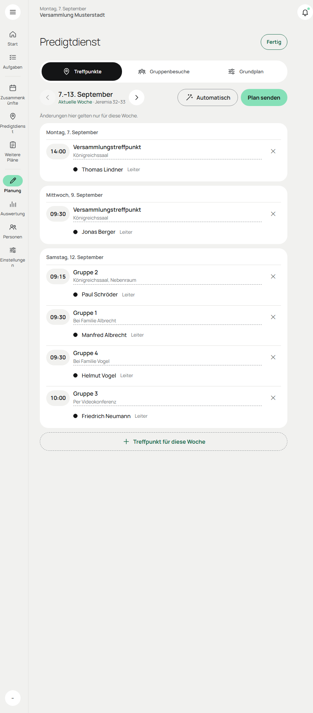

Dafür steht **Plan senden** in der Leiste (am Handy unten, sonst neben der
Woche); die Zahl daran nennt, wie viele Zuteilungen dieser Woche noch niemandem
mitgeteilt sind. Ein Tipp öffnet das Blatt: oben der Stand der Woche, darunter —
sind es nur noch wenige — wer was noch nicht weiß, mit Tag und Aufgabe. Ein
Tipp auf **Plan senden** im Blatt, und jede eingeteilte Person bekommt **eine**
Nachricht mit allen ihren Aufgaben dieser Woche — in der App und, wo aktiviert,
als Push. **Später** schließt das Blatt, ohne zu senden.

Drei Dinge, auf die du dich verlassen kannst:

- **Es geht nichts doppelt hinaus.** Die App merkt sich, welcher Platz mit
  welchem Namen schon gemeldet wurde. Besserst du danach einen Platz nach und
  drückst noch einmal, bekommt nur die neue Person eine Nachricht.
- **Wer kein App-Konto hat, bleibt danach sichtbar stehen.** Diese Namen musst
  du persönlich ansprechen — das Blatt nennt sie dir, auch wenn du es
  zwischendurch schließt, bis du die Woche wechselst.
- **Der Knopf gilt für die ganze Woche**, beide Zusammenkünfte und die
  Treffpunkte. Du musst ihn nicht in jedem Reiter drücken.
- **Was vorbei ist, geht nicht mehr hinaus.** Am Donnerstag zählt der Knopf die
  Plätze vom Dienstag nicht mehr mit, und niemand bekommt eine Nachricht über
  eine Zusammenkunft, die gewesen ist. Am Tag der Zusammenkunft selbst zählt
  sie noch.

Darunter steht, wann für diese Woche zuletzt etwas hinausging.

**Nach dem Senden können sich Verkündiger für Hilfsdienste selbst eintragen.**
Welche Hilfsdienste der Woche noch unbesetzt sind, sehen sie im Menü unter
**Freie Plätze** – jeder nur, wofür er einen Aufgabenbereich hat, an dem Tag
nicht abwesend ist und im selben Dienst noch keinen Platz hat. **Programmpunkte
bietet die App dort nicht an:** Die teilst du zu. Die Reinigung auch nicht. Wer
zuerst tippt, ist eingetragen und hat damit zugesagt; eine Mitteilung bekommst
du dafür nicht, im Plan steht sein Name mit vollem Punkt. Willst du einen Platz
selbst besetzen, tu es vor dem Senden.

> **Eine Ausnahme wartet nicht auf den Knopf.** Nimmst du jemandem eine Aufgabe
> weg, von der er **schon weiß** – er hat sie bestätigt, oder sie wurde ihm mit
> **Plan senden** mitgeteilt –, erfährt er das sofort („Zuteilung
> zurückgezogen"). Wer von seiner Aufgabe weiß, bereitet vor — er soll nicht
> weiter für etwas üben, das ihm nicht mehr gehört. Wer abgesagt hat, bekommt
> nichts. Was du noch nicht gesendet hast, darfst du umsortieren, ohne dass
> jemand etwas merkt.
>
> **Was dabei nicht als „weggenommen" gilt:** eine Zusammenkunft, die du
> ausfallen lässt (in einer Kongress-Woche fallen alle aus) — die Zuteilungen
> ruhen dann nur. Ebenso das Abschalten der Zusätzlichen Klasse: Ihre Namen
> bleiben stehen und kommen beim Einschalten wieder. Und eine berichtigte
> Schreibweise eines Namens ist ohnehin keine Änderung an der Zuteilung. Und ein
> Platz, dessen Termin schon **vorbei** ist: Trägst du am Donnerstag nach, wer
> am Dienstag wirklich gelesen hat, nimmst du niemandem etwas, das er noch
> vorbereiten müsste. In all diesen Fällen geht keine Nachricht hinaus.

### Die Zusagen der Woche

Nach dem Senden willst du wissen, wo die Woche steht. Ein Tipp auf den Schritt
**Zusagen** der Spur öffnet die **Zusagen** der Woche — beide Zusammenkünfte
zusammen, ohne was schon vorbei ist:

- **Zu klären**: wer abgesagt hat, abwesend ist oder an dem Tag schon etwas
  anderes hat — mit dem Grund. **Zuteilen** daneben öffnet den Platz gleich zum
  Neubesetzen. Bei einem Hilfsdienst steht nach einer Absage „Ersatz gesucht":
  Dort fragt die App selbst nach einem Ersatz.
- **Warten auf Zusage**: wer noch nicht zugesagt hat, mit Tag und Aufgabe und
  seit wann die Nachricht draußen ist — oder „noch nicht gesendet". Darunter
  steht, wann die nächste Erinnerung von selbst hinausgeht (so, wie die
  [Erinnerungen](#7-einstellungen) eingestellt sind). **Jetzt erinnern**
  schickt sie sofort — an alle, die die Nachricht schon haben. Wer von seinem
  Platz noch nichts weiß, bekommt zuerst den Plan (siehe
  [Den Plan senden](#den-plan-senden)). Mehr als eine Erinnerung am Tag bekommt
  niemand, ob sie von selbst kommt oder von Hand.
- **Noch nicht angemeldet**: wer beim Senden kein Konto hatte. Ihn hat keine
  Nachricht erreicht — sag es ihm persönlich und setz dann den Haken neben
  seiner Aufgabe. Der Haken bleibt gespeichert, auch für die anderen Planer;
  ein zweiter Tipp nimmt ihn wieder weg. **Der Haken zählt wie eine Zusage**:
  Im Schritt **Zusagen** der Spur ist der Platz damit erledigt, und am Tag der
  letzten Erinnerung steht er nicht mehr in der Meldung „nicht erreichbar".
  Hier unter **Noch nicht angemeldet** bleibt er trotzdem stehen — so siehst
  du, wer in der App zugesagt hat und wem du es selbst gesagt hast.
- **Zugesagt**: die Namen derer, die schon zugesagt haben.

Am Desktop stehen die Karten als Spalten nebeneinander. Zurück — oder der
Schritt **Zuteilen** der Spur — führt wieder in den Plan.

---

## 4a. Auswertung: wie die Zuteilungen verteilt sind

Unter **Planen und verwalten** → **Auswertung** siehst du, wie sich die
Zuteilungen der vergangenen Wochen auf die Versammlung verteilen: wer zu oft
oder zu selten dran ist, wer immer dasselbe macht, wer lange wartet, wo die
Plätze knapp sind und wo oft abgesagt wird. Die Auswertung sehen nur Planer und
Admins. Sie rechnet aus den Wochen, die die App kennt; drucken lässt sie sich
nicht.

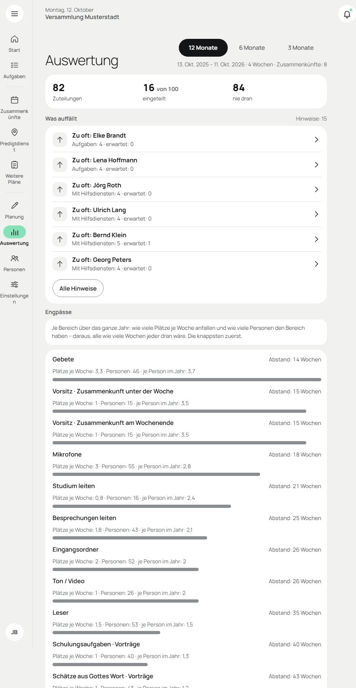

- **Zeitraum** – 12, 6 oder 3 Monate, bis vor die laufende Woche. Darunter
  steht, welche Tage das sind, wie viele Wochen die App davon kennt und wie
  viele Zusammenkünfte stattfanden. Ausgefallene Zusammenkünfte zählen nicht.
  **Wartezeiten**, **Engpässe** und die **Pflege der Bereiche** rechnen immer
  über das ganze Jahr, gleich welcher Zeitraum gewählt ist: Gewartet wird seit
  dem letzten Mal, nicht seit dem Beginn des Zeitraums.
- **Kennzahlen** – alle Zuteilungen im Zeitraum, wie viele derer mit einem
  Aufgabenbereich eingeteilt waren und wie viele nie dran waren. Wer den ganzen
  Zeitraum abwesend oder noch nicht dabei war, zählt hier nicht mit.
- **Was auffällt** – das Wichtigste zuerst: zu selten, zu oft, einseitig,
  lange Wartezeit, viele Absagen, dann die Pflege der Bereiche (**Ohne Bereich
  eingeteilt**, **Bereich im Jahr ungenutzt**). Je Person und Art steht nur der
  deutlichste Fall da; wer lange wartet, steht je Bereich mit den ersten drei
  Namen. Ein Tipp öffnet die Person – bei einer langen Wartezeit die
  Wartezeiten mit diesem Bereich, bei vielen Absagen die Absagen;
  **Alle Hinweise** zeigt den Rest.
- Am Handy führen fünf Kacheln weiter – **Zu oft, zu selten**, **Einseitig
  verteilt**, **Wartezeiten**, **Engpässe** (mit der Zahl der knappen Bereiche),
  **Treffpunkte, Absagen, Ballungen**; Zurück führt wieder in den Überblick. Am
  Tablet steht alles auf einer Seite, die Engpässe unter **Was auffällt**, am
  Computer dazu die Tabelle **Wer bekommt was** (Person × Bereich).

### Was zählt – und was erwartet wird

- Gezählt wird jeder Platz, auf dem eine Person der Versammlung stand –
  Programmpunkte und Hilfsdienste. Der **öffentliche Vortrag** zählt nicht,
  auch nicht beim eigenen Redner: Man hält ihn selten in der eigenen
  Versammlung. Namen ohne Person zählen nicht, die Reinigung (sie geht an
  Gruppen) auch nicht.
- **Feste Rollen** zählen nicht: der feste Leiter des Wachtturm-Studiums und
  was dem Vorsitz folgt, etwa das Anfangsgebet des Vorsitzenden und am
  Wochenende das Lesen des Wachtturms.
- **Erwartet** ist, was auf eine Person käme, wenn jeder Platz gleich auf alle
  verteilt wäre, die ihn in seiner Zusammenkunft hätten haben können: die den
  Bereich haben und da waren. Wer in einer Zusammenkunft fehlte, von dem wird
  für ihre Plätze nichts erwartet. Wer das Wachtturm-Studium leitet – der feste
  Leiter oder sein Vertreter –, von dem werden in dieser Zusammenkunft kein
  Vorsitz und kein Lesen erwartet.
- **Dabei seit** – erwartet wird erst ab der ersten Woche, in der jemand
  irgendwo eingeteilt war: Ein Zugezogener stünde sonst unter „zu selten". Wer
  noch nie eingeteilt war, gilt als von Anfang an dabei; wer erst für eine
  kommende Woche eingeteilt ist, ebenso. Die Kehrseite: Wer lange übersehen und
  dann einmal eingeteilt wurde, gilt erst ab da als dabei und fällt nicht mehr
  auf.
- Eine Einteilung in einem Bereich, den die Person **nicht hat**, zählt nicht
  gegen ihre Erwartung – sie steht unter **Ohne Bereich eingeteilt** (siehe
  *Pflege der Bereiche*).
- **Zu oft, zu selten** heißt: mehr als die Hälfte über oder unter der
  Erwartung **und** mindestens drei daneben – damit nicht jede kleine
  Abweichung auffällt.
- Die Ansicht **Zu oft, zu selten** vergleicht wahlweise die **Aufgaben**
  (Programmpunkte, die Schulungsaufgaben eingeschlossen) oder alles **mit den
  Hilfsdiensten**. Den zweiten Vergleich gibt es, weil „Automatisch" die
  Hilfsdienste nach der Gesamtlast verteilt: Wer viele Aufgaben hat, bekommt
  weniger Hilfsdienste.
- Jede Zeile nennt die Zahl gegen die Erwartung („Aufgaben: 7 · erwartet: 1“)
  und sagt rechts neben dem Namen in einem Wort, wie es steht: **6 mehr** (rot),
  **passt** (grau) oder **3 weniger** (gestrichelt). Gezählt wird gegen die
  gerundete Erwartung, die in der Zeile steht.

### Einseitig verteilt

Einseitig ist, wer mindestens sechs Zuteilungen hat und zwei Drittel davon in
einem Bereich – und damit deutlich mehr, als dort zu erwarten ist: Wer
Mikrofone und Bibellesung hat, hat zwangsläufig vor allem Mikrofone, weil es
dort viel mehr Plätze gibt. Einseitig ist auch, wer in einem eigenen Bereich
nie dran war, obwohl die anderen ihn im Schnitt mindestens viermal hatten und
auf die Person selbst wenigstens ein Platz gekommen wäre. Ein Bereich, der
schon unter **Bereich im Jahr ungenutzt** steht, steht hier nicht noch einmal.
Die Karten zeigen je Person ihre Bereiche mit Balken; **Alle** zeigt auch die
Unauffälligen.

Am Computer zeigt die Tabelle **Wer bekommt was** jede Person mit jedem
Bereich: je dunkler das Feld, desto öfter. Gestrichelt heißt, sie hat den
Bereich, war dort aber nie dran; ein Strich, sie hat ihn nicht; umrandet, sie
war dort eingeteilt, ohne den Bereich zu haben. Die Spaltenköpfe stehen
senkrecht, damit die Tabelle ohne Rollen in die Breite passt. Ein Tipp auf
einen Namen öffnet die Person.

### Wartezeiten

Je Bereich – oben auszuwählen – steht da, wer am längsten nicht dran war,
über das ganze Jahr. **Üblicher Abstand** ist der des Bereichs: die Personen,
die ihn haben, geteilt durch seine Plätze je Woche (wie unter **Engpässe**).
Eine **lange Wartezeit** hat, wer mehr als doppelt so lange wartet; wer im Jahr
nie dran war, wartet seit der ersten Woche, in der der Bereich in der App
vorkommt. Zur Wartezeit zählen nur Wochen, in denen die Person hätte
drankommen können: nicht abwesend, eine Zusammenkunft mit Plätzen des Bereichs
fand statt, kein fester Platz wie die Leitung des Wachtturm-Studiums, schon
dabei. Die übrigen stehen als **davon nicht einteilbar: …** dabei.

Jede Zeile nennt die Wartezeit gegen den üblichen Abstand („seit 14 Wochen ·
üblich: 6 Wochen“), dazu das letzte Mal; wer eine lange Wartezeit hat, trägt
neben dem Namen rot **wartet lange**.

Nicht lange wartet, wer im Bereich schon für diese oder eine kommende Woche
eingeteilt ist (**geplant: …** – diese Zeilen stehen hinten) und wer übers Jahr
insgesamt über der eigenen Erwartung liegt (**insgesamt über der Erwartung**):
Wer viel zu tun hat, wartet nicht auf ein Gebet. Bei ihnen steht dann kein
**wartet lange**.
Darunter **Schnell wieder dran**: wer mindestens dreimal dran war, mit
höchstens halb so viel Abstand wie üblich – je Woche ein Feld.

### Engpässe

Je Bereich über das ganze Jahr: die **Plätze je Woche**, die **Personen**, die
den Bereich haben, daraus der **Abstand** – alle wie viele Wochen jeder dran
wäre – und wie oft **je Person im Jahr**. Gezählt werden die Wochen ab der
ersten, in der der Bereich einen Platz hatte: Aus New World Scheduler kommen
die Hilfsdienste oft nur wenige Monate zurück.

Oben stehen nur die **knappen Bereiche**: die, in denen jeder öfter als alle
vier Wochen dran wäre, und die, die niemand hat – mit dem Rat, mehr Personen
freizugeben (den Aufgabenbereich vergibst du bei der Person). Ist keiner knapp,
steht das in einem Satz da. Darunter stehen **Alle Bereiche**, die knappsten
zuerst. Die Kachel am Handy zählt die knappen Bereiche.

### Pflege der Bereiche

- **Ohne Bereich eingeteilt** – wer im Jahr mindestens zweimal in einem
  Bereich eingeteilt war, den die Person nicht hat: Vielleicht fehlt ihr der
  Bereich unter **Personen**. Ein einziges Mal gilt als Aushilfe.
- **Bereich im Jahr ungenutzt** – wer einen Bereich hat, in dem auf die Person
  im Jahr mindestens drei Plätze gekommen wären, und nie dran war: Vielleicht
  stimmt der Bereich nicht mehr.

### Treffpunkte, Absagen, Ballungen

- **Treffpunkte leiten** – wer die Zusammenkünfte für den Predigtdienst
  geleitet hat, je Gruppe. Eine Gruppe steht nur da, wenn sie im Zeitraum
  eigene Treffpunkte hatte.
- **Absagen je Bereich** – wie viele Zuteilungen eines Bereichs abgesagt
  wurden, gemessen an allen seinen Zuteilungen im Zeitraum; bei den Treffpunkten
  an den geleiteten. Gezählt wird jede Absage, auch wenn der Platz danach neu
  besetzt wurde – nach denselben Regeln wie die Zuteilungen: Eine Absage des
  öffentlichen Vortrags oder des festen Studienleiters zählt nicht, und wer den
  Vorsitz absagt, dem zählen Anfangsgebet und Lesen nicht als zweite Absage. Nimmt
  jemand seine Absage zurück (**Doch bestätigen**), zählt sie nicht mehr. Eine
  Absage auf einem Platz ohne Bereich – etwa einem, den es im Plan nicht mehr
  gibt – zählt nur bei der Person, nicht hier und nicht in der Kachel. Hat
  ein Bereich mindestens drei Absagen und doppelt so viel Anteil wie jeder
  andere, steht er rot da und unter **Was auffällt**.
- **Ballungen** – wer in einer Zusammenkunft einen Hilfsdienst und noch einen
  Platz hatte, oder drei Wochen und mehr hintereinander im selben Bereich. Zwei
  Programmpunkte derselben Person in einer Zusammenkunft zählen nicht: Das ist
  meist ein gewolltes Paar, etwa Vorsitz und Wachtturm-Lesen.

### Eine Person

Ein Tipp auf einen Namen zeigt die Person: ihre Aufgaben gegen die Erwartung,
ihre Hilfsdienste, wie oft sie abwesend war und wie oft sie abgesagt hat, ihre
Wochen und je Bereich, wie oft und wann zuletzt – mit **mehr**, **passt** oder
**weniger** wie unter **Zu oft, zu selten**. Hinten stehen die Bereiche, in
denen sie eingeteilt war, ohne sie zu haben (**Bereich nicht vorhanden**, ohne
Erwartung).

Die **Wochen** stehen als Kalender da: je Monat eine Zeile, der neueste oben.
Jede Woche hat zwei Felder – zuerst die Zusammenkunft unter der Woche, dann die
am Wochenende. Grün ist eine Aufgabe, grau ein Hilfsdienst, halb und halb
beides in derselben Zusammenkunft; schraffiert war die Person abwesend, rot
umrandet hat sie abgesagt, durchgestrichen fand die Zusammenkunft nicht statt.
Zu jedem Monat steht da, welche Aufgaben es waren (kam dieselbe öfter, mit der
Zahl), welche Treffpunkte die Person geleitet hat und was abgesagt wurde – am
Handy unter den Feldern, auf größeren Bildschirmen daneben. Treffpunkte haben
kein Feld: Sie sind keine Zusammenkunft.

Was noch aussteht, steht gestrichelt oben – bis zur letzten Woche, in der die
Person eingeteilt oder abwesend ist oder einen Treffpunkt leitet; dann heißt die
Überschrift „Die letzten … Wochen und was ansteht“. Entscheidend ist der Tag:
Am Donnerstag ist die Zusammenkunft vom Dienstag gehalten und steht gefüllt da,
die am Sonntag gestrichelt. Gezählt wird die laufende Woche trotzdem erst ab
Montag, wie überall in der Auswertung.

### Was die Auswertung nicht weiß

- Sie kennt nur die Wochen, die die App aufbewahrt – ein Jahr (Abschnitt 11).
  Sind erst wenige Wochen da, sind die Zahlen klein, und es fällt mehr auf, als
  es sollte.
- Abwesenheiten kennt sie, soweit sie in der App stehen. Aus New World
  Scheduler kamen sie erst ab dem Tag des Imports; für die Wochen davor rechnet
  die Auswertung so, als wäre jeder da gewesen.
- Seit wann jemand dabei ist, schließt sie aus der ersten Einteilung (siehe
  **Dabei seit**). Seit wann jemand einen Bereich hat, weiß sie nicht: Für
  einen frisch vergebenen Bereich rechnet sie, als hätte die Person ihn schon
  das ganze Jahr. Sie kann deshalb unter „zu selten" stehen, ohne dass etwas
  schief liegt.
- Absagen merkt sich die App seit dem 17. Oktober 2026. Was davor abgesagt und
  schon neu besetzt war, fehlt in der Auswertung.

---

## 5. Treffpunkte planen

Die **Zusammenkünfte für den Predigtdienst** („Treffpunkte") sind ein eigenes
Thema im Menü: **Predigtdienst**. Schalte oben rechts auf **Planen**; darunter
wählst du den Bereich: **Treffpunkte**, **Gruppenbesuche** (siehe unten) und
**Grundplan** – drei große Felder über die ganze Breite, jedes mit seinem
Zeichen, das gewählte kräftig hinterlegt. Bei großer Schrift und auf sehr
schmalen Handys stehen sie untereinander. Die **Trolleys** stehen nur beim
**Ansehen** (siehe [Trolleys](#trolleys)).

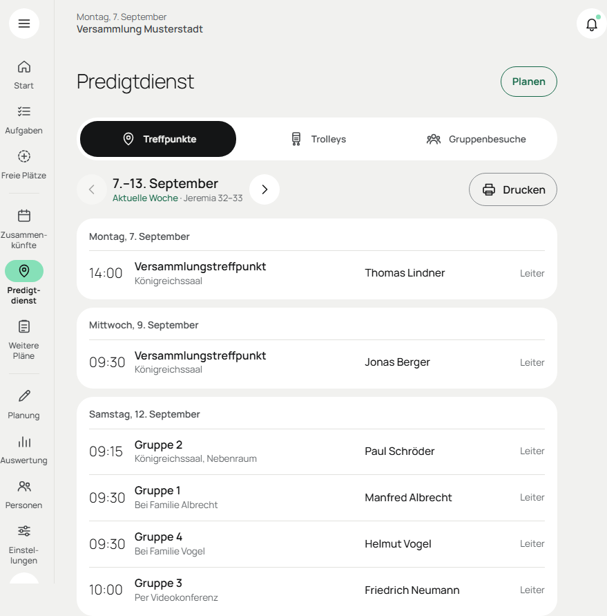

Es gibt zwei Arten:

- **Versammlungstreffpunkte** – gelten für die ganze Versammlung.
- **Gruppentreffpunkte** – je Predigtdienstgruppe, mit eigenem Ort und Leiter.

Der regelmäßige Rhythmus kommt aus dem **Grundplan**: die regelmäßigen
Versammlungs‑ und Gruppentreffpunkte mit Wochentag, Uhrzeit, Ort und
Häufigkeit (jede Woche oder etwa „Jeden 1. im Monat"). Er steht wie die Woche
je Wochentag in einer Karte, jeder Treffpunkt mit Uhrzeit, Titel
(Versammlungstreffpunkt oder der Name der Gruppe) und Ort; was nicht jede Woche
gilt, nennt seine Häufigkeit. Ein Tipp öffnet den Treffpunkt: Wochentag,
Häufigkeit, Uhrzeit und Ort gelten sofort, bei einer Gruppe auch **Außer bei
Versammlungstreffpunkt**; **Entfernen** fragt vorher nach. **+ Treffpunkt für
jede Woche** legt einen neuen an — erst mit **Hinzufügen**, ohne Ort im Saal
eurer Versammlung. Jede Änderung setzt die Wochenpläne neu auf.

Unter **Treffpunkte** steht die gewählte Woche: je Tag eine Karte, darin jeder
Treffpunkt mit Uhrzeit, Titel und Ort und darunter sein **Leiter**. Der Leiter
steht da wie ein Platz bei den Zusammenkünften – voller Punkt: zugesagt, blass:
wartet, rot: etwas stimmt nicht, und rechts steht, was (abwesend an diesem Tag,
an diesem Tag schon an einem anderen Treffpunkt, abgesagt). Ein Tipp auf den
Leiter öffnet das Zuteilen; am großen Bildschirm steht es in der Spalte rechts
daneben.

- **Uhrzeit und Ort** änderst du direkt am Treffpunkt – nur für diese Woche;
  was jede Woche gilt, gehört in den Grundplan. **✕** nimmt den Treffpunkt aus
  der Woche (zwei Tipps).
- **+ Treffpunkt für diese Woche** legt einen einmaligen an, etwa einen
  Pioniertag: Gruppe (oder Versammlung), Wochentag, Uhrzeit und Ort. Ohne Ort
  nimmt er euren Saal.
- **Automatisch** besetzt die offenen Leiter, **Leeren** nimmt alle wieder heraus
  (zwei Tipps); **Plan senden** teilt die Woche mit. Beide Knöpfe stehen am
  Handy unten in der Leiste, ab dem Tablet rechts neben der Woche.

**Gruppenaufseher** können die Treffpunkte **ihrer** Gruppe selbst planen, ohne
Admin zu sein – Uhrzeit, Ort, Leiter, zusätzliche Treffpunkte und den Grundplan
ihrer Gruppe. Den Schalter **Planen** sehen sie nur im Predigtdienst, im
Grundplan nur die Treffpunkte ihrer Gruppe (neue legen sie dort ohne Wahl der
Gruppe an); **Automatisch** wirkt nur auf ihre Gruppe,
und mit **Plan senden** benachrichtigen sie die Leiter ihrer Gruppe. Planer und
Admin planen die Treffpunkte aller Gruppen ganz, samt Grundplan.

Beim **Ansehen** sieht, wer zuteilt, die Treffpunkte **aller** Gruppen — je Tag
eine Karte. **Deine Gruppe** steht dann am Treffpunkt der eigenen Gruppe, nicht
am Tag (dort meinte es eine von mehreren).

> **Wer sieht was.** Einen Gruppentreffpunkt zeigt das Programm nur den
> Verkündigern **dieser** Gruppe (und ihrem Aufseher). Versammlungstreffpunkte
> sehen alle. Du als Planer siehst weiterhin alles — du planst ja für jede
> Gruppe.

**Der Leiter kann auch jemand von außerhalb sein.** In der Dienstwoche leitet
in der Regel der **Kreisaufseher** den Treffpunkt, und der steht in keiner
Personenliste. Tippe den Treffpunkt-Leiter an: Oben im Blatt gibst du einen
**Namen als Freitext** ein und bestätigst mit **ÜBERNEHMEN** — darunter steht
weiterhin die Liste der eigenen Verkündiger, falls es doch jemand von euch
sein soll. Beide Wege führen zurück, du kannst also jederzeit wechseln.

> Ein Freitext-Leiter hat die App nicht: Er bekommt keine Aufgabe und keine
> Erinnerung, sein Platz steht gleich voll da (es gibt nichts zu bestätigen),
> und er zählt bei niemandem auf die Auslastung. Auch dann nicht, wenn er
> zufällig so heißt wie jemand bei euch.

### Gruppenbesuche des Dienstaufsehers

Der Dienstaufseher besucht **jeden Monat an einem Wochenende eine andere
Gruppe** und leitet dann ihre Zusammenkünfte für den Predigtdienst (so steht es
im Buch *Organisiert, Jehovas Willen zu tun*, Kapitel 5). Unter
**Predigtdienst › Planen › Gruppenbesuche** planst du diese Besuche.

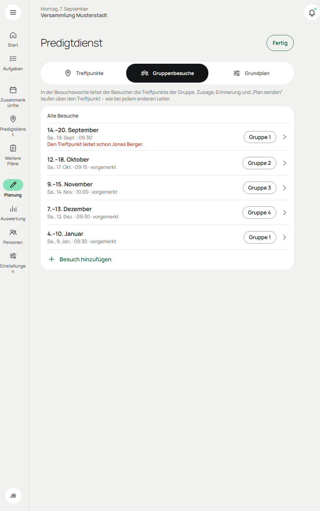

- **Ein Besuch ist eine Woche und eine Gruppe.** Der Besucher wird in dieser
  Woche **Leiter der Treffpunkte der Gruppe**. Alles Weitere läuft über den
  Treffpunkt wie bei jedem anderen Leiter: Er bestätigt die Aufgabe, bekommt
  Erinnerungen, und „Plan senden" teilt sie ihm mit. Am Treffpunkt steht in
  dieser Woche **„Besuch des Dienstaufsehers"**.
- **Die Besuche stehen in einer Karte**, jeder als Zeile: die Woche, darunter
  Tag und Uhrzeit des Treffpunkts, rechts die Gruppe. Vergangene stehen noch
  zwei Monate blass als Rückblick da.
- **Besuch hinzufügen** unten in der Karte legst du jeden Besuch selbst an —
  es sind ja höchstens zwölf im Jahr. Das Blatt schlägt vor, was du
  vermutlich eingibst: die **Gruppe, die am längsten nicht dran war**, die
  **Woche einen Monat nach dem letzten Besuch** (dasselbe Wochenende im
  nächsten Monat) und den **Besucher des letzten Besuchs**. Passt etwas
  nicht, änderst du es; erst **Hinzufügen** legt an. Zur Wahl als Besucher
  steht, wer Treffpunkte leiten darf.
- **Ein Tipp auf einen Besuch** öffnet ihn: **Woche und Gruppe** verlegen ihn
  — der Besucher geht dann aus den bisherigen Treffpunkten und leitet die
  neuen; hatte er dort schon zugesagt, verfällt diese Zusage. Gesperrt ist,
  was es schon gibt: eine Woche, in der die Gruppe bereits besucht wird. Der
  **Besucher** lässt sich für diesen einen Besuch ändern. **Entfernen** fragt
  vorher nach; der Treffpunkt ist danach wieder frei.
- **Vorgemerkt** heißt: Das Programm der Woche ist noch nicht geholt. Der Besuch nennt
  vorab den Treffpunkt laut Grundplan und wird eingetragen, sobald ihr
  Programm geholt ist.

**Mögliche Konflikte** stehen an der Zeile und im Blatt des Besuchs:

| Konflikt | Was du tun kannst |
| --- | --- |
| Den Treffpunkt leitet schon jemand anders | **Übernehmen** — der Besucher leitet. Wusste der andere schon davon (zugesagt oder gesendet), bekommt er sofort die Nachricht, dass die Zuteilung zurückgezogen ist. |
| Der Treffpunkt hat noch keinen Leiter | **Eintragen** — etwa, wenn der Treffpunkt erst nach dem Besuch im Grundplan entstand. |
| Die Gruppe trifft sich in dieser Woche nicht | Am Besuch eine andere Woche wählen. |
| Der Besucher ist abwesend | Anderen Besucher wählen oder die Woche ändern. |

Konflikte der Gruppenbesuche nennt auch die **Planungs‑Karte auf der
Startseite** — unabhängig von ihren vier Wochen, denn ein Besuch liegt oft
Monate voraus, und gerade dann lässt sich noch etwas ändern.

**Alle sehen die Besuche**: Im Predigtdienst steht beim **Ansehen** oben auch
**Gruppenbesuche**, sobald einer ansteht — darin die Besuche bei der eigenen
Gruppe mit Treffpunkt, darunter alle in Kurzform. Gruppenaufseher planen die
Besuche nicht.

### Trolleys

Für den Trolley braucht es keinen Plan: Man steht mit ihm nur eine
Viertelstunde an einem Platz, und was zählt, ist, dass man sich verabreden
kann. Deshalb **plant niemand, und niemand sagt zu**. Beim Planen gibt es dafür
kein Feld; die **Trolleys** stehen beim **Ansehen** des Predigtdienstes oben
neben **Treffpunkte**, sobald die Versammlung einen hat – für alle mit dem
Trolley-Recht, für alle mit einem eigenen Termin dort und immer für Admin und
Planer. Ein Tipp
darauf öffnet den Kalender der Trolleys. Auch die Planungs‑Karte der
Startseite und **Plan senden** kennen sie nicht.

- **Die Trolleys legt der Admin an**, in den Einstellungen mit dem Ort, an dem
  man sie abholt (siehe [Gruppen und Trolleys](#gruppen-und-trolleys)).
- **Wer mit dem Trolley gehen darf**, legt der Aufgabenbereich **Trolley** bei
  der Person fest (siehe [Aufgabenbereiche](#aufgabenbereiche)). Ohne ihn sieht
  man die Termine, kann sich aber nicht eintragen – auch als Admin oder Planer
  nicht.
- **Eintragen, Dazukommen und Austragen** beschreibt das
  [Handbuch für Verkündiger](verkuendiger.md#trolleys). Eingetragen wird
  immer man selbst, auf Wunsch gleich mit einem Partner. Austragen kann sich
  nur, wer im Termin steht – einen anderen austragen kann niemand, auch der
  Admin nicht.
- **Die Mitteilungen schickt der Server, nicht das Gerät.** Eintragen,
  Dazukommen und Austragen laufen über ihn: Er prüft Recht und Zeiten und sagt
  erst dann dem anderen Bescheid. So kann niemand einem anderen eine Mitteilung
  schicken, ohne ihn wirklich ein- oder ausgetragen zu haben. Am Vortag
  erinnert die App alle, die eingetragen sind (siehe
  [Erinnerungen](#erinnerungen)).

---

## 5a. Weitere Pläne

Im Menü unter **Weitere Pläne** stehen Pläne, die nur **ankündigen**: Niemand
muss etwas bestätigen, niemand wird erinnert, und einen „Plan senden" gibt es
dafür nicht. Jeder Plan gilt dem **Königreichssaal** – Reinigung und
Instandhaltung. „Im Allgemeinen wechseln sich die Predigtdienstgruppen mit der
Saalreinigung ab" (*Organisiert, Jehovas Willen zu tun*, Kap. 11 Abs. 10): je
Woche oder je Monat eine Gruppe. Was zu tun ist, sagt der Name des Plans, etwa
„Winterdienst" oder „Grundreinigung".

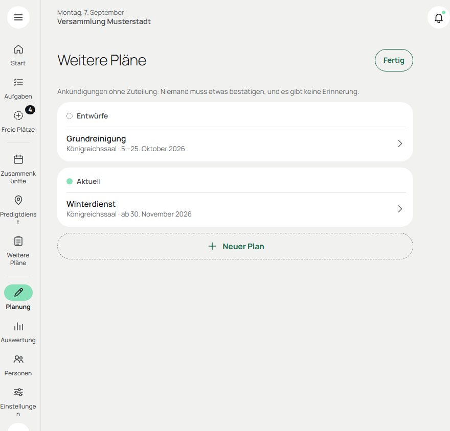

Die Liste zeigt je Stand eine Karte: **Entwürfe**, **Aktuell** und
**Abgeschlossen** (der letzte Tag ist vorbei). Unter jedem Namen steht, wann
der Plan gilt – beim laufenden „bis …", beim kommenden „ab …", beim
abgeschlossenen „endete am …", beim Entwurf sein Zeitraum. Ein Tipp öffnet den
Plan in **Plan bearbeiten**; oben zeigt eine Spur, wo er steht (Entwurf,
Veröffentlicht, Abgeschlossen), und Zurück führt wieder zur Liste.

- **Neuer Plan** legt den Plan als **Entwurf** an – ab dieser Woche für ein
  Vierteljahr – und öffnet ihn gleich. Den Namen tippst du dort ein.
- **Von** und **Bis** öffnen den Kalender auf dem Ende, auf das du tippst; der
  neue Zeitraum gilt erst mit **Übernehmen**. Wird er kürzer, gehen die
  Einträge außerhalb mit.
- **Die Gruppen wechseln** stellt den Takt ein: **Jede Woche** (so ist jeder
  Plan zuerst) oder **Jeden Monat**. Im Monatstakt steht je Kalendermonat eine
  Zeile („Oktober 2026"). Stellst du um, geht es in derselben Reihenfolge
  weiter, nur im neuen Takt: Ab der laufenden Woche bzw. dem laufenden Monat
  wird neu verteilt, beginnend mit der Gruppe, die gerade dran ist. Was vorbei
  ist, bleibt erhalten.
- **Beginnen mit** verteilt mit einem Tipp: Die Wochen (bzw. Monate) ab der
  laufenden bis zum Ende bekommen die Gruppen der Reihe nach, beginnend mit der
  gewählten. Gedrückt steht die Gruppe, mit der die Reihe gerade beginnt; ein
  Tipp darauf ändert nichts. Vergangene Wochen bleiben, wie sie sind.
- Reihum gehen nur die Gruppen, die **reinigen**: Hast du eine im Blatt der
  Reinigung abgeschaltet (siehe [Hilfsdienste](#hilfsdienste)), steht sie
  weder bei **Beginnen mit** noch in der Vorschau zur Wahl, und auch beim
  Umstellen des Takts überspringt die Reihe sie. Wo sie schon eingetragen ist,
  bleibt sie stehen, bis du die Zeile umstellst oder neu verteilst.
- Die **Vorschau** zeigt die nächsten fünf Wochen oder Monate, **Alle anzeigen**
  auch die übrigen und die vergangenen. Jede kommende Zeile stellst du einzeln
  um.
- **Veröffentlichen** macht den Plan sichtbar, **Zurück zum Entwurf** nimmt
  ihn wieder zurück. Einen Entwurf sehen nur Admins und Planer. Am Handy steht
  der Knopf unten in der Leiste, ab dem Tablet neben dem Titel.
- **Drucken** steht davor – am Handy vorn in der Leiste (bei großer Schrift
  darüber), ab dem Tablet neben dem Titel – und druckt den Bogen des Plans,
  auch eines Entwurfs: zum Durchsehen, bevor die Versammlung ihn sieht (siehe
  [Pläne drucken](#9-pläne-drucken)).
- **Plan löschen** fragt einmal nach.

Ein abgeschlossener Plan bleibt in der Liste stehen, zum Nachsehen: Verteilen,
Veröffentlichen und Drucken gibt es dort nicht mehr. Planer und Admin pflegen
einen Plan gleich.

**Wer was sieht**: Einen Plan sieht nach dem Veröffentlichen die ganze
Versammlung, und jeder findet oben unter „Deine Gruppe ist dran" die Wochen
(bzw. Monate) seiner Gruppe. Für Verkündiger steht „Weitere Pläne" erst im Menü, wenn es für
sie etwas zu sehen gibt.

---

## 6. Personen verwalten

Unter **Personen** pflegst du alle Mitglieder der Versammlung.

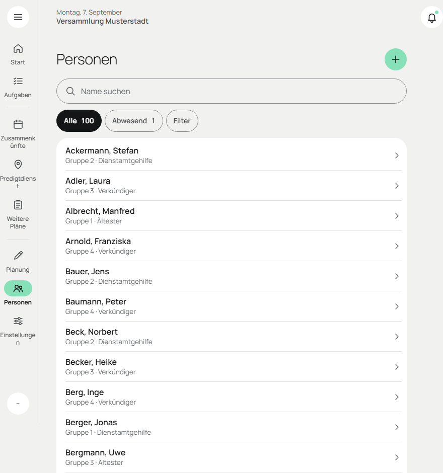

- Die Liste steht alphabetisch nach dem **Nachnamen** und zeigt ihn deshalb
  zuerst: „Krüger, Simon". Überall sonst – bei der Person, in den Zuteilungen,
  in Mitteilungen – steht der Name wie gesprochen: „Simon Krüger".
- Unter jedem Namen stehen **Gruppe und Rolle**, rechts das Recht (**Admin**
  oder **Planer**). Wer heute abwesend ist, steht mit dem Zeitraum da, etwa
  „abwesend 7.–11. September".
- Der **Punkt** vor dem Namen zeigt, wie weit die Person mit der App ist:
  voll – **angemeldet** (ein Konto ist mit ihr verknüpft), blass – **Link
  gesendet** (sie hat einen gültigen Link, per E‑Mail oder auf einem Zettel,
  aber noch kein Konto), gestrichelt – **ohne Link**. Ein abgelaufener Link zählt
  wie keiner. Wer nicht angemeldet ist, steht statt mit der Rolle mit seinem
  Stand da: Er erfährt nichts von selbst, weder „Plan senden" noch die
  Erinnerungen erreichen ihn.
- Oben zählt die Karte **Stand der Anmeldung** alle drei. Ein Tipp auf eine
  Zahl zeigt nur diese Personen, ein zweiter wieder alle. Darunter stehen
  **Alle**, **Noch nicht angemeldet** (mit Link oder ohne) und
  **Abwesend** (wer heute fehlt), jeweils mit ihrer Zahl. Am Desktop stehen die
  drei Stände gleich in dieser Reihe.
- In der Auswahl **Ohne Link** steht **Links senden**. Das Blatt teilt die
  Personen, die die Liste gerade zeigt: **Per E‑Mail** bekommt jede mit
  Adresse ihren eigenen Link (**So sieht die E‑Mail aus** zeigt sie vorher),
  **Ohne E‑Mail‑Adresse** druckst du die Zettel. Teilen sich mehrere eine
  Adresse, bekommt trotzdem jede ihren eigenen Link. Suche und Filter grenzen
  dabei mit ein – so gibst du etwa einer Gruppe nach der anderen ihren Zugang.
  Es gehen nur die Links hinaus; den Plan sendest du wie gewohnt.
- Kann die App gerade keine E‑Mails senden, sagt **Links senden** es und
  ersetzt keinen Link. Dann druckst du die Zettel, oder du schickst den Link bei
  der Person aus deinem eigenen Mail‑Programm (siehe unten).
- Über **Name suchen** findest du schnell eine Person – gesucht wird in **Name,
  Telefonnummer und E‑Mail‑Adresse**. Bei Telefonnummern ist die Schreibweise
  egal: „01701234567" findet auch „0170 123 4567".
- **Filter** öffnet ein Blatt, in dem du die Liste nach **Geschlecht**,
  **Rolle**, **Predigtdienstgruppe** und **Aufgabenbereich** einschränkst
  (jeweils alphabetisch sortiert). Die Felder wirken zusammen (z. B. alle Brüder
  aus Gruppe 2 mit dem Bereich Mikrofone); „—" bedeutet „nicht eingeschränkt",
  **Zurücksetzen** hebt alle vier auf. Unter **Aufgabenbereich** stehen auch die
  beiden festen Rollen **Wachtturm-Studium-Leiter** und **Vertreter
  (Wachtturm-Studium)** – so findest du schnell, wer sie trägt. Am Knopf steht,
  wie viele Felder gesetzt sind, über der Liste, wie viele Personen übrig
  bleiben.
- Suche und Filter bleiben stehen, wenn du eine Person öffnest und
  zurückkommst – so lassen sich die Gefundenen nacheinander bearbeiten. Erst ein
  anderer Bildschirm setzt sie zurück.
- **Person anlegen** (der runde Knopf mit dem Plus, am Desktop mit dem Wort)
  öffnet ein Blatt: Vorname, Nachname, E‑Mail (freiwillig), Geschlecht, Gruppe
  und Rolle. Angelegt wird erst mit **Hinzufügen**; danach öffnet sich die neue
  Person, und du legst ihre Aufgabenbereiche fest. Einen Namen, den es schon
  gibt, nimmt das Blatt nicht an – es nennt, wer ihn trägt.
- Ein Tippen auf eine Person öffnet sie. Am Desktop steht sie rechts neben der
  Liste, ihre Zeile ist umrandet:

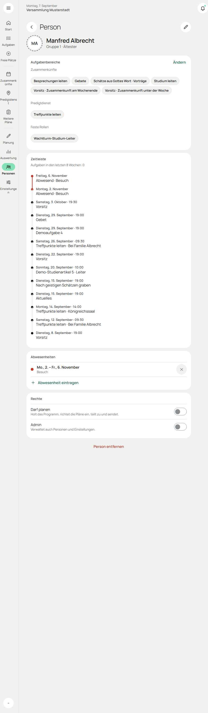

### Die Person

Oben stehen Name, Gruppe und Rolle, daneben der **Stift** für
[Person bearbeiten](#person-bearbeiten). Darunter folgen Karten:

- **Konto** – wie weit die Person mit der App ist, als Spur mit drei
  Schritten: **Angelegt**, **Link gesendet** (mit dem Tag), **Angemeldet**.
  Darunter steht, was als Nächstes geht. **Link senden** öffnet ein Blatt mit
  drei Wegen: **Per E‑Mail** an die Adresse der Person – kann die App gerade
  nicht senden, öffnet sich dieselbe E‑Mail in deinem Mail‑Programm –,
  **Per Nachricht** oder **Auf einem Zettel** mit QR‑Code und Code zum
  Eintippen. **Per Nachricht** geht auch ohne Adresse: **Teilen** öffnet das
  Teilen deines Handys (WhatsApp, Signal, SMS …), **Kopieren** legt den Text
  in die Zwischenablage, etwa für WhatsApp am Computer. Der Text ist der der
  E‑Mail mit Link und Code; ist er abgelaufen, verweist er an die Ältesten.
  **Schick ihn nur in den persönlichen Chat der Person, nie in eine Gruppe:**
  Wer den Text hat, kann sich als diese Person anmelden. Ein Konto anlegen
  oder ein Passwort wählen muss niemand: Das Konto entsteht bei der ersten
  Anmeldung. Hat die Person einen Link, steht daneben **Zettel drucken**; ein
  neuer Link ersetzt den alten, auch den auf einem Zettel. Ist die Person
  angemeldet, steht die Adresse ihres Kontos da, und das ✕ nimmt das Konto aus
  der Versammlung – mit ihm geht ihr Link. Beim eigenen fehlt es.
- **Zettel** druckt die App auf A4, sechs je Blatt zum Ausschneiden, in der
  Sprache der Versammlung: Name, QR‑Code, Code und bis wann er gilt. Der
  Zettel meldet an – gib ihn nur der Person selbst.
- **Die E‑Mail trägt denselben Code** wie der Zettel, unter dem Link. Auf dem
  iPhone braucht man ihn: Der Link öffnet dort immer Safari, nie die App vom
  Home‑Bildschirm, und angemeldet wird man in der App nur über
  **Code eintippen**. Lässt sich jemand auf der Anmeldeseite mit **Link
  senden** einen neuen Link schicken, kommt auch ein neuer Code – sein Zettel
  gilt danach nicht mehr. Teilen sich mehrere eine Adresse, gilt das für jeden
  von ihnen.
- **Aufgabenbereiche** – als Chips, was die Person übernehmen darf, nach
  Gruppen geordnet. **Ändern** öffnet die Schalter (siehe
  [Aufgabenbereiche](#aufgabenbereiche)).
- **Zeitleiste** und **Abwesenheiten** – siehe unten. Unter dem Titel der
  Zeitleiste steht, wie viele Aufgaben die Person in den letzten acht Wochen
  hatte; so siehst du vor dem Zuteilen, wer zuletzt viel hatte.
- **Rechte** – siehe [Rechte](#rechte).

Ganz unten steht **Person entfernen**. Der erste Tipp nennt die Folge, erst der
zweite entfernt. Bereits geplante Zuteilungen bleiben als Text in den Wochen
stehen. Hat die Person ein Konto, geht es mit: Ihr Gerät wird abgemeldet, und
anmelden geht erst wieder mit einem neuen Link. Nur dein eigenes Konto bleibt –
es steht dann unter **Konten ohne Person**.

### Zeitleiste und Abwesenheiten

Die **Zeitleiste** zeigt die Aufgaben dieser Person aus den geladenen Wochen,
die neuesten zuerst, jeweils mit Wochentag, Datum und Uhrzeit – Programmpunkte,
Hilfsdienste, geleitete Treffpunkte und Trolley-Termine (diese ab der
laufenden Woche). Beim Dienstaufseher stehen auch seine **vorgemerkten
Gruppenbesuche** darin – Besuche in Wochen, deren Programm noch nicht geholt ist, an
den Tagen laut Grundplan. Am selben Tag steht das Spätere oben, Aufgaben
derselben Zusammenkunft in der Reihenfolge des Programms. Vergangenes wird
blasser dargestellt und reicht höchstens acht Wochen zurück; was ansteht,
steht ganz da. Unter dem Titel steht „Aufgaben in den letzten 8 Wochen: …“ –
gezählt wird, was blass dasteht, ohne die Abwesenheiten. Hat jemand in dieser
Zeit weder Zuteilung noch Abwesenheit, entfällt die Karte.

Den genauen Tag rechnet die App aus: Das Arbeitsheft kennt nur die Woche, der
Wochentag und die Uhrzeit stehen in den [Einstellungen](#7-einstellungen)
(„Dienstag 19:00"). Weicht eine Woche davon ab – z. B. das Gedächtnismahl –,
gilt der Termin dieser Woche.

In derselben Leiste stehen die **Abwesenheiten** – die Gegenrichtung zu den
Zuteilungen: wann diese Person **nicht** da ist. Ein Zeitraum bekommt zwei
Punkte, für Beginn und Ende, und die Strecke dazwischen ist eingefärbt. So ist
auf einen Blick zu sehen, was in einen Zeitraum hineinfällt – eine Zuteilung
mitten in einer Abwesenheit sitzt sichtbar in der farbigen Strecke. Ein
einzelner Tag ergibt einen Punkt, über den Aufgaben dieses Tages.

Die Karte **Abwesenheiten** darunter nennt, was ansteht oder gerade läuft; was
vorbei ist, fällt heraus. Eingetragen wird dort mit **Abwesenheit eintragen**:
ein Kalender, in dem du den ersten und den letzten Tag antippst, optional ein
Grund. Entfernt wird mit dem ✕ an der Zeile – der erste Tipp fragt nach, erst
der zweite entfernt. Als Admin trägst du hier für andere ein (nach einem Anruf
„wir sind im Oktober weg"); die meisten Verkündiger haben kein Konto und können
es nicht selbst. Wer eines hat, sieht dieselben Einträge in seinem **Profil**
und kann sie dort ebenfalls pflegen – es ist dieselbe Angabe, nicht zwei.

Abwesenheiten wirken sofort auf die Planung: Wer weg ist, lässt sich für diese
Woche gar nicht erst zuteilen, die automatische Zuteilung übergeht ihn, und eine
bereits bestehende Zuteilung erscheint unter **Zu klären**. Bei den Treffpunkten
zählt dabei der Wochentag des jeweiligen Treffpunkts, nicht die ganze Woche.

### Person bearbeiten

Der **Stift** öffnet das Blatt **Person bearbeiten**:

- **Vorname** und **Nachname**, **Telefon**, **E‑Mail**, **Geschlecht**.
- **Predigtdienstgruppe** – Zuordnung zur Gruppe. Jeder Verkündiger braucht
  eine; fehlt sie, warnt die Personenliste. Jeder gehört genau einer Gruppe
  an. Ist die Person **Aufseher** oder **Gehilfe** ihrer Gruppe, steht darunter
  etwa „Aufseher dieser Gruppe – bei einem Wechsel endet das Amt." Wechselst
  du ihre Gruppe (oder stellst „—" ein), ist sie es in der alten Gruppe nicht
  mehr; die hat dann keinen Aufseher bzw. Gehilfen, bis du unter
  [Gruppen und Trolleys](#gruppen-und-trolleys) jemand Neues wählst.
- **Rolle** – Ältester, Dienstamtgehilfe, Verkündiger oder **Keine** (für
  Schüler ohne Verkündiger‑Status).
- **Familie** – wer zur selben Familie gehört. Familienangehörige dürfen bei
  Schülerteilen auch geschlechtsübergreifend Gesprächspartner sein (z. B.
  Ehepaar, Vater/Tochter). Über das Auswahlfeld kommt jemand dazu, das ✕ am
  Namen nimmt ihn wieder heraus.

Alles außer dem Namen gilt sofort. Der Name gilt erst, wenn du das Blatt
schließt (**Fertig**) – beim Tippen entsteht so kein halber Name in den Plänen.
Wird eine Person umbenannt, zieht die App den neuen Namen automatisch durch alle
bereits geplanten Wochen.

### Aufgabenbereiche

**Ändern** in der Karte **Aufgabenbereiche** öffnet ein Blatt mit einem
Schalter je Bereich, in vier Gruppen. Jede steht alphabetisch, nur die festen
Rollen in ihrer Folge.

- **Zusammenkünfte** – welche Aufgaben die Person übernehmen darf (Vorsitz,
  Vorträge, Besprechungen leiten, Gebet, Bibellesung, Schulung …). Diese
  Bereiche steuern, wen die Automatik und die Kandidatenlisten vorschlagen.
  Drei davon klingen ähnlich und sind doch getrennt:
  - **Schätze aus Gottes Wort · Vorträge** – der Vortrag zu Beginn von „Schätze
    aus Gottes Wort".
  - **Besprechungen leiten** – „Nach geistigen Schätzen graben", die
    Besprechungen unter „Uns im Dienst verbessern" (z. B. „Was würdest du
    sagen?") und alle Punkte unter „Unser Leben als Christ" außer dem
    Versammlungsbibelstudium.
  - **Schulungsaufgaben · Vorträge** – der Vortrag eines Schülers unter „Uns im
    Dienst verbessern".

  Nennt das Arbeitsheft einen Punkt unter „Uns im Dienst verbessern" einen
  **Vortrag des Vorsitzenden** (seit Januar 2027), steht dort der Platz des
  Vorsitzes unter der Woche – kein Schüler und kein Partner, kein S-89.

  Den **öffentlichen Vortrag am Sonntag** regelt kein Bereich: Zur Wahl stehen
  dort alle Ältesten und Dienstamtgehilfen. Eingeteilt wird er ohnehin von
  Hand – die Automatik lässt ihn aus.
- **Hilfsdienste** – dasselbe für die Dienste (Ton, Mikrofone, Ordner …).
- **Predigtdienst** – **Treffpunkte leiten** und **Trolley** (wer mit dem
  Trolley gehen darf, siehe [Trolleys](#trolleys)).
- **Feste Rollen** – die beiden des Wachtturm-Studiums:
  - **Wachtturm-Studium-Leiter** – der feste Leiter des Wachtturm-Studiums.
  - **Vertreter (Wachtturm-Studium)** – sein Vertreter.

  Den Leiter-Platz des Wachtturm-Studiums bekommt der feste Leiter von selbst:
  Schon beim **Holen** einer Woche steht er darin (siehe
  [Programm holen](#8-programm-holen)), und das automatische Zuteilen nimmt ihn
  ebenso zuerst. Ist er am Tag der Zusammenkunft abwesend oder schon
  eingeteilt – etwa mit dem öffentlichen Vortrag –, kommt sein Vertreter.
  Fehlen beide, bleibt der Platz beim Holen offen, und die Automatik verteilt
  ihn wie jeden anderen unter allen mit dem Bereich **Studium leiten**.

  Trägt der Leiter eine Abwesenheit erst ein, wenn er schon in der Woche steht,
  ändert sich der Plan nicht von selbst: Die Planung meldet den Konflikt (siehe
  [Konflikte und offene Zuteilungen](#4-konflikte-und-offene-zuteilungen)), und
  beim Zuteilen steht sein Vertreter als **Vorschlag** oben. Jede der beiden
  Rollen gehört genau einer Person; ist eine mehrfach vergeben, warnt die
  Personenliste (siehe
  [Warnung: feste Rolle mehrfach vergeben](#warnung-feste-rolle-mehrfach-vergeben)).

### Rechte

Die Karte **Rechte** hat zwei Schalter:

- **Darf planen** – holt das Programm, richtet die Pläne ein, teilt zu und
  sendet.
- **Admin** – verwaltet auch Personen und Einstellungen: alles, was dieses
  Handbuch beschreibt. Das Planer-Recht hat er ohnehin; bei ihm steht **Darf
  planen** an und lässt sich nicht umlegen.

Was Planer und Admin im Einzelnen dürfen, steht unter „Wer darf was" in
Abschnitt 1. Hat die Person noch kein Konto, merkt die App die Rechte vor; sie
gelten, sobald sie sich zum ersten Mal mit ihrem Link anmeldet. Deine eigenen
Schalter kannst du nicht umlegen – so sperrt sich niemand selbst aus.

### Zwei Personen mit demselben Namen

Vor- und Nachname zusammen gibt es in einer Versammlung nur einmal. Gibst du
einer Person in **Person bearbeiten** einen Namen, den schon jemand trägt,
erscheint direkt unter dem Nachnamen ein Hinweis, der die andere Person nennt:
„Diesen Namen trägt bereits Paul Beispiel. Ergänze den Vornamen, damit beide
unterscheidbar sind."

Ergänze dann gleich den Vornamen, etwa zu „Paul sen." oder um einen zweiten
Vornamen. Sobald der Name eindeutig ist, verschwindet der Hinweis.

Schließt du das Blatt, während der Hinweis noch steht, behält die Person ihren
bisherigen Namen – in der Liste und in den bereits geplanten Wochen. Unten am
Bildschirm erscheint dazu kurz „Name nicht geändert: Paul Beispiel gibt es
schon". Ebenso bei einem leeren Namen: „Name nicht geändert: Ohne Namen geht es
nicht". Was du sonst im Blatt geändert hast, etwa Telefon oder Gruppe, bleibt
gespeichert. Beim **Anlegen** nimmt das Blatt einen solchen Namen gar nicht
erst an.

Verglichen wird der ganze Name, wie er angezeigt wird. Groß- und
Kleinschreibung und doppelte Leerzeichen zählen dabei nicht – „paul beispiel"
ist derselbe Name wie „Paul Beispiel". Akzente zählen dagegen: „Müller" und
„Muller" dürfen nebeneinanderstehen.

Der Grund für die Regel: Auf den Plänen und Ausdrucken steht nur der Name. Zwei
Gleichnamige wären dort nicht auseinanderzuhalten.

### Warnung: feste Rolle mehrfach vergeben

Leiter und Vertreter des Wachtturm-Studiums sind je **eine** Person. Ist einer
der beiden Schalter bei mehreren eingeschaltet, erscheint über der Liste der
Hinweis **Feste Rollen** mit einer Zeile je Rolle, etwa
„Wachtturm-Studium-Leiter" · 2 Personen, und darunter den Namen aller, die sie
tragen. Beim automatischen Zuteilen nimmt die App dann irgendeinen von ihnen –
nicht unbedingt den, den du meinst.

Abhilfe: Tippe im Hinweis auf einen Namen. Es öffnet sich die Person, dort
schaltest du unter **Aufgabenbereiche › Ändern** bei den **Festen Rollen** die
Rolle ab, wenn sie nicht zu ihr gehört – an bleibt sie nur bei einer Person. Der Hinweis gilt für die ganze
Versammlung, Suche und Filter blenden ihn nicht aus. Er verschwindet, sobald
jede Rolle höchstens einmal vergeben ist.

### Warnung: ohne Predigtdienstgruppe

Jeder Verkündiger gehört zu einer Predigtdienstgruppe. Ist jemand keiner
zugeordnet, erscheint über der Liste der Hinweis **Ohne Predigtdienstgruppe**
mit allen betroffenen Namen. Das passiert zum Beispiel nach dem Löschen einer
Gruppe: Ihre Mitglieder stehen danach ohne Gruppe da.

Das hat eine sichtbare Folge: Ein Gruppentreffpunkt erscheint im Programm nur
bei den Mitgliedern **dieser** Gruppe. Wer ohne Gruppe dasteht, sieht nur die
Treffpunkte der Versammlung.

Abhilfe: Tippe im Hinweis auf einen Namen. Es öffnet sich die Person, dort
wählst du über den Stift (**Person bearbeiten**) unter **Predigtdienstgruppe**
die richtige Gruppe. Der Hinweis gilt
für die ganze Versammlung, Suche und Filter blenden ihn nicht aus. Er
verschwindet, sobald alle zugeordnet sind.

Nicht gewarnt wird bei Personen mit der Rolle **Keine**, also Schülern ohne
Verkündiger‑Status: Sie gehören zu keiner Gruppe. Solange noch gar keine Gruppe
angelegt ist, bleibt der Hinweis ebenfalls aus.

### Konten ohne Person

Über der Personenliste steht die Karte **Konten ohne Person**: angemeldete
Konten, die noch keinem Eintrag zugeordnet sind. Solange die
Zuordnung fehlt, sieht dieses Konto **keine eigenen Aufgaben** — die App weiß
ja nicht, wer dahintersteht. Über das Auswahlfeld ordnest du das Konto der
richtigen Person zu; mit ✕ entfernst du es aus der Versammlung. Dabei wird das
Konto gelöscht: Seine Geräte werden abgemeldet, seine Zusagen gehen mit, und
anmelden geht erst wieder mit einem neuen Link. Dasselbe gilt für **Konto
entfernen** in der Konto-Karte einer Person.

---

## 7. Einstellungen

Unter **Einstellungen** pflegst du, was für die ganze Versammlung gilt: ihren
Namen und ihre Sprachen, wann die Zusammenkünfte sind, die Hilfsdienste, die
Predigtdienstgruppen, die Trolleys und die Erinnerungen. Die Einstellungen
sieht nur, wer Admin ist.

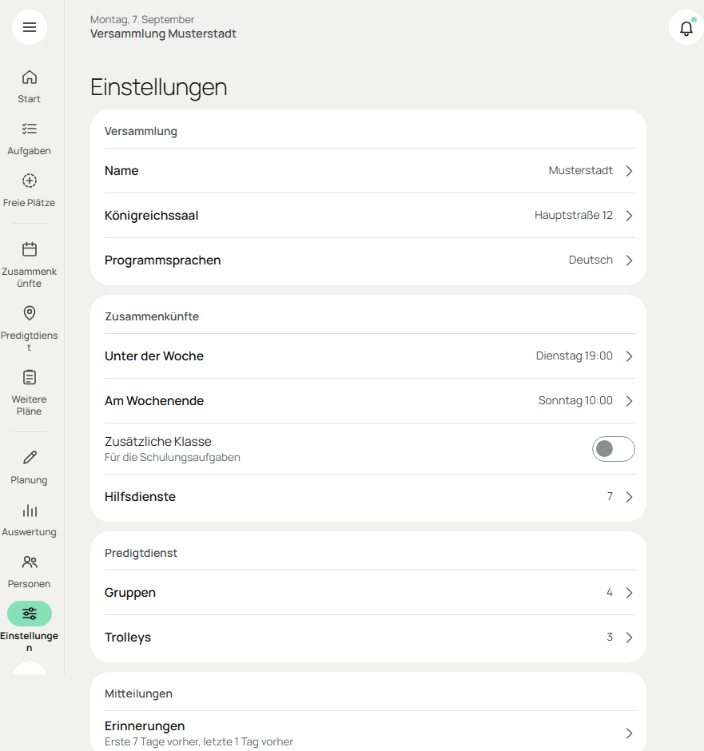

Am Handy stehen untereinander fünf Karten:

- **Versammlung** – **Name**, **Königreichssaal** und **Programmsprachen**.
- **Zusammenkünfte** – **Unter der Woche** und **Am Wochenende**, der Schalter
  **Zusätzliche Klasse** und die **Hilfsdienste**.
- **Predigtdienst** – die **Gruppen** und die **Trolleys**, je mit ihrer Zahl;
  beide Zeilen öffnen dieselbe Seite **Gruppen und Trolleys**.
- **Mitteilungen** – die **Erinnerungen**.
- **Wer plant** – alle, die planen dürfen.

Das Programm der Wochen holst du nicht hier, sondern bei den Wochen unter
**Planung** ([Abschnitt 8](#8-programm-holen)); bis zum 15. Oktober 2026 stand
der Import als letzte Karte in den Einstellungen.

Jede Zeile nennt, was eingestellt wird, und dazu, was gerade gilt – etwa
„Dienstag 19:00". So siehst du alles auf einen Blick, ohne etwas zu öffnen. Ein
Tipp auf die Zeile öffnet ein Blatt, in dem du es änderst. Hinter
**Programmsprachen**, **Hilfsdienste**, **Gruppen**, **Trolleys** und
**Erinnerungen** liegt statt eines Blatts eine eigene Seite, eine Ebene unter
der Übersicht – oben führt der Pfeil zurück, ebenso die Zurück-Taste.

Was du einstellst, gilt sofort. Ein Speichern gibt es nicht; **Fertig** schließt
nur das Blatt. Drei Ausnahmen: Ein neuer Hilfsdienst entsteht erst mit
**Hinzufügen**, der Name einer Gruppe gilt erst, wenn du ihr Blatt schließt,
und bei einem Trolley gelten Name, Abholort und Hinweis ebenso erst beim
Schließen.

Am Desktop stehen links untereinander die Abschnitte – **Versammlung**,
**Zusammenkünfte**, **Hilfsdienste**, **Gruppen und Trolleys**, **Mitteilungen
und Erinnerungen** und **Wer plant** –, jeder mit einer
Kurzfassung darunter, etwa „Dienstag 19:00 · Sonntag 10:00" oder
„Gruppen: 4 · Trolleys: 3". Rechts steht der gewählte Abschnitt mit allem, was
am Handy hinter seinen Zeilen liegt. Zuerst ist **Versammlung** gewählt; die
Sprachen stehen dort gleich unter Name und Königreichssaal. Die Hilfsdienste
sind am Desktop ein eigener Abschnitt, die Gruppen und die Trolleys je eine
Tabelle.

### Versammlung und Sprachen

- **Name** – der Name der Versammlung. Er steht oben in der App und auf den
  ausgedruckten Plänen. Am Handy setzt die App „Versammlung" davor
  („Versammlung Musterstadt") – trag deshalb nur den Namen selbst ein.
- **Königreichssaal** – die Anschrift eures Saals. Ein Treffpunkt, für den du
  keinen Ort einträgst, bekommt sie als Ort (siehe
  [Treffpunkte planen](#5-treffpunkte-planen)).

Beide öffnen ein Blatt mit einem Feld; was du tippst, gilt sofort.

**Programmsprachen** öffnet eine eigene Seite. In der Zeile steht schon, was
gilt: zuerst die Sprache der Versammlung, dann die weiteren – „Deutsch,
Englisch".

- **Versammlungssprache** – in ihr holt der Import das Arbeitsheft von jw.org.
  Ein Tipp öffnet die Sprachliste von jw.org mit einem Suchfeld; ein Tipp auf
  eine Sprache wählt sie. Eine neue Versammlungssprache gilt für die nächsten
  Importe – geladene Wochen bleiben in ihrer Sprache.
- **Weitere Programmsprachen** – in diesen Sprachen holt der Import das
  Programm zusätzlich. Wer die App in einer davon benutzt, sieht das Programm
  dann in seiner Sprache – etwa eine englischsprachige Familie in einer
  deutschen Versammlung. **Sprache hinzufügen** öffnet dieselbe Liste, das **✕**
  an einer Sprache nimmt sie wieder heraus (zwei Tipps). Eine neue Sprache holt
  der nächste Import nach, auch für die geladenen Wochen ab der laufenden;
  vergangene Wochen bleiben ohne sie. Eine entfernte holen neue Importe nicht
  mehr; was schon geladen ist, bleibt.

Die Versammlungssprache ist auch die Sprache der **E‑Mail mit dem Link** an
ein neues Mitglied und der **Zettel**: Wer sie bekommt, hat noch kein Konto und
damit keine eigene Spracheinstellung. Jede andere Nachricht kommt in der Sprache des Empfängers –
Push-Erinnerungen in der Sprache, die auf seinem Gerät eingestellt ist, die
Mitteilungen in der App in seiner App-Sprache. Wer Englisch eingestellt hat,
liest „Reminder: confirm your assignment", auch wenn eure Versammlung deutsch
ist.

### Zusammenkünfte

- **Unter der Woche** und **Am Wochenende** – Wochentag und Uhrzeit der beiden
  Zusammenkünfte. Ein Tipp öffnet ein Blatt mit **Wochentag** und **Uhrzeit**
  (in Viertelstunden); beides gilt sofort.
- **Zusätzliche Klasse** („Für die Schulungsaufgaben") – der Schalter für einen
  zweiten Raum, in dem die Schulungsaufgaben parallel laufen. Er gilt für alle
  Wochen; was er bewirkt, steht unter
  [Zusätzliche Klasse](#7a-zusätzliche-klasse).
- **Hilfsdienste** – daneben steht, wie viele es gibt; ein Tipp öffnet sie
  (siehe [Hilfsdienste](#hilfsdienste)).

Das Arbeitsheft kennt nur die Woche. Tag und Uhrzeit jeder Zusammenkunft kommen
von hier – im Programm, in „Meine Aufgaben", auf dem S‑89‑Formular und in den
Erinnerungen. Eine Änderung gilt deshalb für alle Wochen zugleich, auch für die
schon geplanten, und das Ende der Zusammenkunft rückt um dieselbe Zeit mit. Nur
eine Woche mit eigenem Termin behält ihn – eine verlegte Zusammenkunft oder das
Gedächtnismahl. Weicht nur eine einzelne Woche ab, stellst du das unter
**Woche einrichten** ein, nicht hier (siehe
[Sonderwoche: verlegen oder absagen](#sonderwoche-verlegen-oder-absagen)).

### Hilfsdienste

Oben steht: „Die Zahl sagt, wie viele Plätze es je Zusammenkunft gibt. Die
Reihenfolge gilt auch im Programm." Darunter folgen die Dienste in eben dieser
Reihenfolge, je Dienst eine Zeile:

- Links der **Name**, darunter, **für wie viele Personen er freigegeben ist**
  („Personen: 3"). Die Zahl steht dort, weil nur diese Personen den Dienst
  bekommen können – beim Zuteilen von Hand wie mit **Automatisch**. Steht dort
  **Personen: 0** (rot), bleibt sein Platz Woche für Woche offen. So beginnt
  jeder neu angelegte Dienst.
- Rechts mit **−** und **+**, wie viele **Plätze** er je Zusammenkunft hat, 1
  bis 6. Die Zahl gilt sofort für alle Wochen. Verringerst du sie,
  verschwinden die Namen auf den weggefallenen Plätzen aus Programm, Planung
  und „Meine Aufgaben"; gespeichert bleiben sie trotzdem – erhöhst du wieder,
  sind sie zurück.
- Bei der **Reinigung** steht statt der Personen, **wie viele Gruppen
  reinigen** („Gruppen: 4"): Sie geht nicht an eine Person, sondern an eine
  Predigtdienstgruppe. **Automatisch** nimmt Woche für Woche die nächste; von
  Hand wählst du beim Zuteilen eine Gruppe aus (siehe
  [Gruppen und Trolleys](#gruppen-und-trolleys)). Welche Gruppen reinigen,
  legst du in ihrem Blatt fest (siehe unten). **Gruppen: 0** (rot) heißt:
  Entweder hast du alle Gruppen herausgenommen, dann bleibt ihr Platz offen –
  oder es gibt noch keine, dann verteilt **Automatisch** sie über „Gruppe 1"
  bis „Gruppe 3".

Darunter führt **Wer darf was?** zu den **Personen**: Dort vergibst du jeder
Person ihre Aufgabenbereiche, die Hilfsdienste eingeschlossen (siehe
[Aufgabenbereiche](#aufgabenbereiche)). Für einen einzelnen Dienst geht es
schneller über sein Blatt (siehe unten).

**Einen Hilfsdienst anlegen:**

1. Tippe auf **Hilfsdienst hinzufügen**.
2. Gib einen **Namen** ein, etwa „Parkplatz", und tippe auf **Hinzufügen**.
   Solange das Feld leer ist, geht das nicht.
3. Der Dienst steht nun unten in der Liste, mit einem Platz je Zusammenkunft.
   Gleich danach öffnet sich sein Blatt – gib dort frei, wer ihn übernehmen
   darf.

Jeder Dienst außer der Reinigung ist ein **eigener Aufgabenbereich**: Bei jeder
Person steht für ihn ein Schalter unter **Aufgabenbereiche › Ändern** in der
Gruppe **Hilfsdienste** – bei einem neuen Dienst zunächst überall aus.

**Das Blatt eines Dienstes** öffnet ein Tipp auf seinen Namen. Oben steht
**Eigener Aufgabenbereich** mit der Zahl der Freigegebenen („Personen: 3"), bei
der Reinigung **Gruppen-Rotation** mit der Zahl der Gruppen, die reinigen
(„Gruppen: 4"). Darunter:

- **Nach oben** und **Nach unten** – verschieben den Dienst um eine Stelle. Die
  Reihenfolge gilt im Programm und beim Planen.
- **Alle Personen mit je einem Schalter**, sortiert wie die Personenliste,
  darüber ein Suchfeld. Hier gibst du in einem Zug frei, wer den Dienst
  übernehmen darf. Es ist derselbe Schalter wie bei der Person, nur von der
  anderen Seite: dort eine Person und ihre Bereiche, hier ein Dienst und seine
  Personen.
- Bei der **Reinigung** stehen an derselben Stelle **alle Gruppen mit je einem
  Schalter** – in der Reihenfolge der Gruppenliste, denn in ihr geht die
  Reinigung reihum. Ein Suchfeld braucht es bei einer Handvoll Gruppen nicht.
  Schaltest du eine Gruppe ab, reinigt sie nicht mehr: **Automatisch**
  überspringt sie Woche für Woche, beim Zuteilen steht sie nicht mehr zur
  Wahl, und in den [Weiteren Plänen](#5a-weitere-pläne) verteilt **Beginnen
  mit** die Wochen ohne sie. Wieder angeschaltet ist sie wieder dabei; eine
  neue Gruppe reinigt von Anfang an mit. Der Schalter gilt sofort, wie bei den
  Personen. Wo eine abgeschaltete Gruppe schon eingeteilt ist, bleibt sie
  stehen, bis du den Platz neu besetzt – von Hand oder nach **Leeren** mit
  **Automatisch**. Sind alle Gruppen abgeschaltet, bleibt die Reinigung offen;
  das Zuteilen-Blatt sagt dann „Gruppen: 0", und als Admin öffnest du dort mit
  **Reinigung ›** gleich dieses Blatt.
- **Hilfsdienst entfernen** – darüber steht, was mitgeht: „Mit dem Dienst gehen
  seine Plätze in allen Wochen und die Freigaben bei den Personen." Mit den
  Plätzen gehen auch die Namen, die dort schon eingeteilt waren. Wie jedes
  Löschen braucht es zwei Tipps: Der erste fragt „Wirklich löschen?". Legst du später einen Dienst gleichen Namens
  an, beginnt er wieder ohne Freigaben.

Die Reinigung lässt sich entfernen, in der App aber nicht wieder anlegen: Ein
neuer Dienst geht immer an Personen, nie reihum an Gruppen. Das steht in ihrem
Blatt auch über dem Knopf.

### Gruppen und Trolleys

Am Handy führen beide Zeilen der Karte **Predigtdienst** – **Gruppen** und
**Trolleys** – auf diese Seite; am Desktop ist es der Abschnitt **Gruppen und
Trolleys**. Oben stehen die Gruppen, darunter die Trolleys.

Die Karte **Predigtdienstgruppen** nennt jede Gruppe mit Aufseher und Gehilfe
und der Zahl ihrer Personen („Personen: 26"). Am Desktop ist es eine Tabelle
mit den Spalten **Gruppe**, **Aufseher**, **Gehilfe** und **Personen**.

- Ist jemand keiner Gruppe zugeordnet, steht darüber **Ohne Gruppe: 2** mit
  „Bei der Person eine Gruppe wählen". Ein Tipp führt zu den **Personen**, wo
  die Namen stehen (siehe
  [Warnung: ohne Predigtdienstgruppe](#warnung-ohne-predigtdienstgruppe)).
- Wer zu welcher Gruppe gehört, legst du bei der Person fest: in **Person
  bearbeiten** unter **Predigtdienstgruppe** (siehe
  [Person bearbeiten](#person-bearbeiten)).
- Die **Reinigung** verteilt **Automatisch** Woche für Woche reihum auf die
  Gruppen, in der Reihenfolge dieser Liste. Eine neue Gruppe stellt sich hinten
  an. Gruppen, die du im Blatt der Reinigung abgeschaltet hast, überspringt sie
  (siehe [Hilfsdienste](#hilfsdienste)).

**Gruppe hinzufügen** legt sofort eine neue Gruppe an – mit der nächsthöheren
Nummer, nach „Gruppe 4" also „Gruppe 5" – und öffnet ihr Blatt. Aufseher und
Gehilfe wählst du dort, sobald ihr bei den Personen jemand zugeordnet ist.

Ein Tipp auf eine Gruppe öffnet das Blatt **Predigtdienstgruppe**:

- **Name** – frei wählbar, etwa „Gruppe Nord". Er gilt erst, wenn du das Blatt
  schließt; beim Tippen entsteht so kein halber Name in den Plänen. Ein neuer
  Name gilt auch in der schon geplanten **Reinigung**. Bleibt das Feld leer,
  behält die Gruppe ihren Namen, und es erscheint „Name nicht geändert: Ohne
  Namen geht es nicht". Ebenso bei einem Namen, den schon eine andere Gruppe
  trägt – „Name nicht geändert: Gruppe 2 gibt es schon"; Groß- und
  Kleinschreibung zählen dabei nicht. Die Reinigung kennt eine Gruppe nur beim
  Namen, zwei gleich benannte wären dort nicht auseinanderzuhalten.
- **Aufseher** – zur Wahl stehen die Ältesten und Dienstamtgehilfen **dieser
  Gruppe**. **Gehilfe** – jeder Bruder der Gruppe, außer mit der Rolle
  **Keine**. Beides gilt sofort; „—" heißt niemand. Niemand ist beides: Wählst
  du den Gehilfen als Aufseher, rückt er auf, und das Feld **Gehilfe** steht
  danach auf „—" (ebenso umgekehrt).

  Wer eine Gruppe leitet, gehört ihr an, und jeder gehört genau einer an – so
  leitet niemand zwei. Daran erinnert der Satz unter beiden Feldern: „Zur Wahl
  stehen nur Mitglieder dieser Gruppe. Wer zu ihr gehört, legst du bei der
  Person fest." Fehlt jemand in der Auswahl, gib ihm zuerst bei der Person
  diese Gruppe (siehe [Person bearbeiten](#person-bearbeiten)). Wechselt ein
  Aufseher oder Gehilfe später die Gruppe, endet sein Amt hier.

  Aufseher und Gehilfe planen die **Treffpunkte ihrer Gruppe** – Uhrzeit, Ort,
  Leiter und Grundplan – und senden sie, auch ohne Planer- oder Admin-Recht,
  sobald sie mit ihrem Konto angemeldet sind (siehe
  [Treffpunkte planen](#5-treffpunkte-planen)). In der Woche, in der ihre
  Gruppe mit der Reinigung dran ist, gibt **Automatisch** ihnen einen weiteren
  Hilfsdienst nur, wenn sonst niemand frei ist.
- **Treffpunkte** – die regelmäßigen Treffpunkte der Gruppe aus dem Grundplan,
  mit Ort, Wochentag und Uhrzeit. Hier stehen sie nur zum Nachsehen; geändert
  werden sie im Predigtdienst unter **Grundplan**. Hat die Gruppe keine, fehlt
  die Zeile.
- **Mitglieder: 25** – wie viele zu ihr gehören.
- **Wenn du die Gruppe entfernst** – was dabei verloren ginge, und nur, was
  auf diese Gruppe zutrifft:
  - „Die Mitglieder dieser Gruppe sind danach keiner Gruppe mehr zugeordnet."
  - „Die Treffpunkte dieser Gruppe entfallen." – im Grundplan wie in den
    geplanten Wochen.
  - „Ihre Gruppenbesuche entfallen."
  - „In den weiteren Plänen bleiben ihre Zeiträume ohne Gruppe."

**Gruppe entfernen** löscht die Gruppe, wie jedes Löschen mit zwei Tipps: Der
erste fragt „Wirklich löschen?". Ihre Mitglieder stehen danach unter **Ohne
Gruppe**, bis du ihnen bei der Person eine andere Gruppe gibst. Ihre Wochen
(bzw. Monate) in den **Weiteren Plänen** verteilst du dort neu (siehe
[Weitere Pläne](#5a-weitere-pläne)).

Unter den Gruppen steht die Karte **Trolleys**, nach dem Namen geordnet: je
Trolley sein Name, darunter, wo man ihn abholt („abholen: Depot"), rechts, wie
viele Termine noch kommen („Termine: 3"). Am Desktop ist es eine Tabelle mit
den Spalten **Trolley**, **Abholen**, **Hinweis** und **Kommende Termine**.
Darunter steht: „Wer zu welcher Gruppe gehört und wer mit dem Trolley gehen
darf, legst du bei der Person fest." – das Trolley-Recht ist dort der
Aufgabenbereich **Trolley** (siehe [Aufgabenbereiche](#aufgabenbereiche)).

**Trolley hinzufügen** legt sofort einen neuen an – mit der nächsten Zahl,
nach „Trolley 3" also „Trolley 4", das Wort in der Sprache, in der du die App
benutzt – und öffnet sein Blatt. Übersetzt wird der Name nicht: So, wie er
dasteht, sehen ihn alle.

Ein Tipp auf einen Trolley öffnet sein Blatt:

- **Name**, **Wo man ihn abholt** und **Hinweis (freiwillig)**, etwa
  „Schlüssel im Fach neben der Bühne". Alle drei gelten erst, wenn du das Blatt
  schließt (**Fertig**), wie bei einer Gruppe. Bleibt der Name leer oder trägt
  ihn schon ein anderer Trolley, behält er den alten, und ein Hinweis sagt
  warum – etwa „Name nicht geändert: Trolley 2 gibt es schon".
- **Kommende Termine** mit ihrer Zahl – ein Tipp führt zu den Trolleys.
- **Wenn du den Trolley entfernst** – steht da, sobald Termine anstehen: „Die
  kommenden Termine entfallen." und „Wer eingetragen ist, bekommt Bescheid."

**Trolley entfernen** fragt erst nach („Wirklich löschen?"). Dann entfernt ihn
der Server samt seinen Terminen und schickt allen, die für einen kommenden
Termin eingetragen sind, **„Trolley-Termin entfällt"** – dir selbst nicht. Ohne
Verbindung bleibt der Trolley stehen, und das Blatt sagt es.

### Erinnerungen

Unter **Mitteilungen › Erinnerungen** siehst du als Zeitleiste, wie die App eine
Aufgabe begleitet. Sobald du **Plan senden** drückst, bekommt jede eingeteilte
Person sofort **Neue Zuteilung** mit der Bitte um Zusage. Die **Erste
Erinnerung** stellst du mit **−** und **+** ein, 1 bis 21 Tage vor der Aufgabe.
**Täglich wiederholen** erinnert an jedem Tag dazwischen, bis die Zusage da ist.
Bei der **Letzten Erinnerung** wählst du **Am Tag** oder **1 Tag vorher**. Stand
dort noch ein Wert von früher (2 bis 7 Tage), erscheint er als dritte
Möglichkeit, bis du umstellst. Ab der Aufgabe selbst meldet sich die App nicht
mehr. Erinnert wird nur, wer weder zu- noch abgesagt hat – per Push und in der
Glocke, nie per E‑Mail. Wer am Tag der letzten Erinnerung noch offen ist und
keine Push-Benachrichtigungen bekommt, wird dir und den anderen Admins und
Planern gemeldet, damit ihr ihn persönlich erinnert.

Darunter steht unter **Sofort gemeldet**, was ohne jede Einstellung gleich
hinausgeht: eine **Absage** an die Admins und Planer; bei einem Hilfsdienst
zusätzlich **Ersatz gesucht** an alle mit diesem Aufgabenbereich, die an dem
Tag nicht abwesend sind; **Zuteilung zurückgezogen** an die Person, wenn du
ihr einen Platz nimmst, von dem sie schon weiß (zugesagt oder gesendet); und **Trolley-Termin
eingetragen, dazugekommen oder abgesagt** an den Partner – wird ein Trolley
entfernt, an alle Eingetragenen (siehe [Trolleys](#trolleys)).

Unter der Karte steht: „Am Vortag eines Trolley-Termins erinnert die App alle,
die eingetragen sind." Diese Erinnerung kommt einmal, ohne Bitte um Zusage, und
hängt nicht an den Einstellungen oben. E‑Mails verschickt die App nur für
Einladungen und die Anmeldung.

### Wer plant

Die Karte **Wer plant** nennt in einem Satz alle, die zuteilen und senden
dürfen – mit **Darf planen** oder als **Admin** –, nach dem Nachnamen geordnet.
Auch wer noch kein Konto hat, steht dabei, wenn das Recht bei ihm vorgemerkt
ist. Gruppenaufseher und Gehilfen ohne eines der beiden Rechte stehen nicht
dabei: Sie planen nur die Treffpunkte ihrer Gruppe.

Vergeben wird das Recht bei der Person in der Karte **Rechte** (siehe
[Rechte](#rechte)); **Bei der Person ändern** führt zu den **Personen**.

**Nicht hier, sondern bei der Person** stehen ihr Konto mit dem Link, ihre
Rechte, ihre Aufgabenbereiche und ihre Gruppe (siehe
[Personen verwalten](#6-personen-verwalten)). Den **Grundplan der Treffpunkte**
findest du im Predigtdienst (siehe [Treffpunkte planen](#5-treffpunkte-planen)).

---

## 7a. Zusätzliche Klasse

Hat eure Versammlung viele Verkündiger, könnt ihr die **Schulungsaufgaben
parallel in einem zweiten Raum** durchführen – so kommt jeder öfter dran. Den
Schalter dafür findest du in den Einstellungen unter **Zusammenkünfte**.

Ist er eingeschaltet, ändert sich Folgendes:

- Beim **Planen** haben die Schülerteile zwei Reihen: **Hauptsaal** und
  **Zusätzliche Klasse**. Betroffen sind die **Bibellesung** und alles unter
  **Uns im Dienst verbessern** – genau die Teile, die nach dem Programmpunkt
  „Nach geistigen Schätzen graben" im zweiten Raum stattfinden.
- Es kommt eine Karte für den **Ratgeber** dazu. Für jede zusätzliche Klasse
  soll ein befähigter Ratgeber zur Verfügung stehen, vorzugsweise ein Ältester. Damit du
  jemanden auswählen kannst, setze bei der Person unter
  **Aufgabenbereiche › Ändern** den Schalter **Ratgeber**.
- **Automatisch zuteilen** besetzt beide Räume und achtet darauf, dass niemand
  gleichzeitig im Hauptsaal und in der Klasse eingeteilt ist.
- Im **Programm** und im **Ausdruck** stehen beide Räume untereinander, jeder
  mit seiner Überschrift.
- Auf dem **S‑89‑Formular** steht jetzt der richtige Raum. Vorher stand dort
  immer „Hauptsaal".

**Ausschalten behält deine Planung.** Die Zuteilungen der Klasse bleiben
gespeichert und sind wieder da, sobald du den Schalter erneut einschaltest.
Solange er aus ist, gibt es die Klasse aber wirklich nicht: Sie steht weder im
Programm noch im Ausdruck, zählt nicht zu den offenen Zuteilungen und es geht
keine Erinnerung dafür hinaus. Neu einzuteilen ist nach dem Wiedereinschalten
nur der **Ratgeber**.

---

## 8. Programm holen

Das Programm einer Woche holt die App aus dem Arbeitsheft auf jw.org – mit
Liedern, Bibelbuch, Schulungspunkten und dem Ablauf der Zusammenkünfte. Sind
weitere Programmsprachen eingestellt, kommen ihre Fassungen gleich mit. Holen
dürfen Planer und Admin.

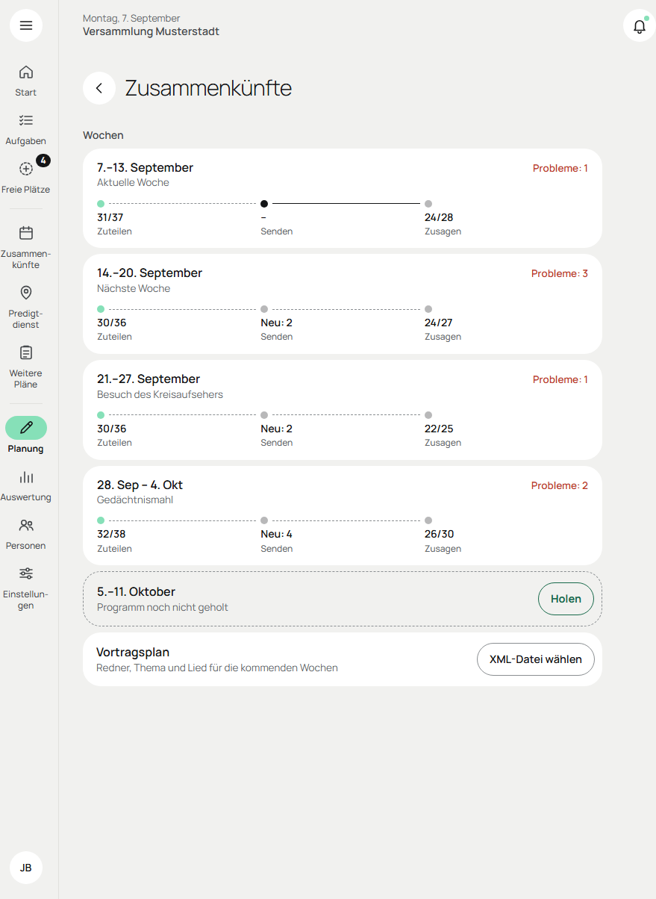

**Die Wochen** erreichst du über **Planung** im Menü und dort
**Zusammenkünfte** (oder **Alle Wochen** auf der Startseite). Am Handy und am
Tablet ist das eine eigene Seite mit allen Wochen ab der laufenden; Zurück
führt von dort zur Auswahl auf **Planung**. Am breiten Bildschirm stehen die
Wochen links neben dem Plan, die gezeigte Woche umrandet. Jede Woche nennt
rechts, was zu tun ist – **Probleme**, **Offen** oder **Bereit zum Senden** –,
darunter, wann sie ist oder was sie besonders macht, und unten, wie weit sie
ist: **Zuteilen**, **Senden**, **Zusagen** – am breiten Bildschirm als Punkte,
darunter der Schritt, an dem die Woche steht. Ein Tipp öffnet ihren Plan; am
breiten Bildschirm wechselt er nur die Woche. Unter den Wochen steht
gestrichelt die nächste, deren Programm noch fehlt, mit **Holen**, darunter der
**Vortragsplan** mit **XML-Datei wählen** für die Datei aus eurem
Planungsprogramm ([Vortragsplan übernehmen](#vortragsplan-übernehmen)).

**Holen** öffnet das Blatt **Programm holen**. Es zeigt erst, was aus dem
Arbeitsheft kam: die Woche, ihre Abschnitte mit der Zahl der Programmpunkte
und die Programmsprachen. Dann wählst du:

- **Übernehmen und zuteilen** – die Woche kommt dazu, ihr Plan öffnet sich, und
  die offenen Plätze der ganzen Woche werden automatisch besetzt. Feste Rollen
  und Abwesenheiten werden dabei beachtet.
- **Nur übernehmen** – die Woche kommt dazu; zugeteilt wird später.
- **Abbrechen** – nichts ändert sich.

Mit beiden Arten zu übernehmen steht der **feste Leiter des Wachtturm-Studiums**
gleich in der Woche – ist er am Tag der Zusammenkunft abwesend oder schon
eingeteilt (etwa mit dem öffentlichen Vortrag aus dem Vortragsplan), sein
Vertreter. Kann keiner von beiden oder ist keine feste Rolle vergeben, bleibt
der Platz offen (siehe [Aufgabenbereiche](#aufgabenbereiche)).

Jedes Holen bringt genau eine weitere Woche, und es läuft nicht von selbst.
Liegt die zuletzt geholte Woche schon zurück, beginnt es bei der laufenden –
vergangene Wochen holt es nicht nach.
Damit es nicht in Vergessenheit gerät, erinnert dich die **Planungs‑Karte auf
der Startseite**, sobald die Programme weniger als drei Wochen voraus reichen –
mit **„Geladen bis …"** und demselben **Holen** (Abschnitt 1).

**Die App arbeitet mit den letzten 52 Wochen.** Ältere Wochen bleiben gespeichert
und gehen nicht verloren, werden beim Start aber nicht mehr mitgeladen – ein Jahr
reicht für alles, was die App mit Wochen tut, und der Start bleibt schnell. Beim
Blättern kommst du deshalb nur bis zur ältesten geladenen Woche zurück.

---

## 9. Pläne drucken

Gedruckt wird nicht der Bildschirm, sondern ein eigener **Bogen auf A4** – für
den Aushang am schwarzen Brett. Jedes Blatt nennt oben die Versammlung, was
gedruckt ist, und den Zeitraum samt Jahr; unten den **Stand** (den Tag, an dem
du gedruckt hast), den Hinweis, dass Änderungen in der App stehen, und die
Seitenzahl. Freie Plätze stehen **gepunktet** da, zum Eintragen von Hand. Wo am
Bildschirm **„Du"** steht, druckt der Bogen den Namen – der Aushang gilt
allen. Tonflächen gibt es nicht: Browser drucken Hintergründe nur auf Wunsch,
deshalb trägt der Bogen über Linien und Schrift.

### Zusammenkünfte und Treffpunkte

Beim **Ansehen** der Zusammenkünfte steht neben dem Termin jeder Zusammenkunft
das **Drucker**‑Zeichen – und im **Predigtdienst** über den Treffpunkten
genauso. Ab dem Tablet steht stattdessen der Knopf **Drucken** rechts neben
der Woche. Ein Tipp darauf öffnet das Blatt **Drucken** mit der Wahl; erst
**Drucken** darin druckt:

- **Diese Woche** (vorgewählt) – beide Zusammenkünfte auf einem Blatt: links
  unter der Woche, rechts das Wochenende, je Programmpunkt die Personen mit
  ihrer Rolle (beim Gastredner seine Versammlung), darunter die
  **Hilfsdienste** beider Tage. Fällt ein Tag aus,
  steht er durchgestrichen da, mit dem Grund.
- **Ganzer Monat · September 2026** – alle Wochen des Monats, knapp: je
  Programmpunkt eine Zeile, die Namen rechts, Schüler und Partner in einer.
  Auf ein Blatt kommen so viele Wochen, wie passen; eine Woche wird nie
  zerteilt. Eine Kongresswoche steht mit einem Satz da, dazu, wann die nächste
  Zusammenkunft ist.

Aus welchem Reiter du druckst – unter der Woche oder Wochenende –, ist gleich:
Der Bogen nimmt immer beide Zusammenkünfte mit.

Bei den **Treffpunkten** druckt dasselbe Blatt die Woche oder den Monat: die
Treffpunkte der **Versammlung** und der **Gruppen** je Datum, mit Uhrzeit, Ort
und Leiter. Darunter steht, was **anders ist als sonst** – ein Treffpunkt des
Grundplans, der entfällt, einer, der dazukommt, einer mit anderer Zeit oder
anderem Ort, ein Besuch des Dienstaufsehers –, und die nächsten
**Gruppenbesuche**. Wer zuteilt, druckt alle Gruppen; sonst stehen die
Versammlung und die eigene Gruppe auf dem Bogen, wie am Bildschirm.

### Welche Wochen zum Monat gehören

**Zum Monat gehört jede Woche, deren Montag in ihm liegt.** Die Woche vom
28. September bis 4. Oktober steht also auf dem September‑Blatt, die vom
5. Oktober auf dem Oktober‑Blatt – so hängt jede Woche an genau einem Aushang.

Gedruckt wird nur, was **geladen** ist. Wochen, deren Programm noch nicht
geholt ist oder die außerhalb der geladenen 52 Wochen liegen (siehe
[Abschnitt 8](#8-programm-holen)), fehlen auf dem Blatt. Wenn ein Monat
unvollständig herauskommt, lohnt vorher ein Blick, ob die Wochen überhaupt
schon da sind.

### Die Pläne ohne Woche

Auch die **Gruppenbesuche**, die **Trolleys** und die **Weiteren Pläne** haben
beim **Ansehen** einen **Drucken**‑Knopf. Gedruckt wird ohne Auswahl:

- **Gruppenbesuche** – die kommenden Besuche mit Woche, Treffpunkt und Gruppe.
  Den Treffpunkt einer fremden Gruppe nennt der Bogen nur, wenn du zuteilst.
- **Trolleys** – zwei Wochen ab der Woche, die du gerade siehst: je Tag eine
  Zeile, je Trolley eine Spalte. Gestrichelt steht, wo jemand einen Partner
  sucht; darunter die Hinweise der Trolleys.
- **Weitere Pläne** – je Woche oder Monat des Zeitraums die Gruppe, die dran
  ist, und ihr Gruppenaufseher; eine Woche ohne Gruppe steht gepunktet da. Bei
  mehreren Plänen kommt der aufs Blatt, den du oben gewählt hast. Aus **Plan
  bearbeiten** druckst du ihn auch als Entwurf, zum Durchsehen vor dem
  Veröffentlichen (siehe [Weitere Pläne](#5a-weitere-pläne)).

Eine lange Tabelle – ein Plan über ein Jahr, die Treffpunkte eines Monats mit
vielen Gruppen – läuft auf dem nächsten Blatt weiter.

### S‑89: die Aufgabenzuteilung

Für Schulungsaufgaben gibt es zusätzlich das **S‑89‑Formular** – die
Aufgabenzuteilung, die sonst auf Papier ausgeteilt wird. Du erreichst es beim
Zuteilen (im Sheet unter dem Titel) und der Verkündiger unter **Meine
Aufgaben**.

Es enthält Name und Gesprächspartner, Datum, Aufgabe, Schulungspunkt und den
Raum (**Hauptsaal** oder **Zusätzliche Klasse**). Alle Angaben kommen aus der
Zuteilung und dem importierten Programm – auszufüllen ist nichts. Da jeder
Beteiligte es in der App sieht, muss es nicht ausgedruckt und verteilt werden.

Soll es doch Papier sein: Alle Zettel einer Woche druckst du beim Planen unter
der Karte **Besetzung** (siehe [Planen](#2-planen-zuteilungen-vornehmen)),
sechs je Blatt zum Ausschneiden. Ab dem Tablet druckt **Diesen Zettel drucken**
im Formular nur den einen Zettel.

---

## 10. Ohne Internet (offline)

Die App startet auch ohne Internet und zeigt den **letzten geladenen Stand**.
Zeigt das Gerät Empfang an, kommt aber nichts durch, dauert das ein paar
Sekunden. Ein Hinweisstreifen nennt den Zeitpunkt der Aufnahme:

Ohne Netz heißt er **„Offline"**. Hat das Gerät Netz und die Daten lassen nur
auf sich warten, heißt er **„Verbindung langsam"** – kommen sie noch, ersetzen
sie den Stand still; scheitert das Laden, wird daraus wieder „Offline".

**Planen ist offline gesperrt.** Zuteilen, automatisch zuteilen, Personen
bearbeiten, Einstellungen ändern und Holen funktionieren nur online. Beim
Versuch erscheint ein kurzer Hinweis; die Schaltflächen bleiben sichtbar, damit
du siehst, was verfügbar wäre.

Das ist Absicht: Zwei Planer, die offline unabhängig voneinander planen, würden
sich beim nächsten Verbinden gegenseitig überschreiben. Deshalb gibt es
**keine** Offline-Änderungen mit späterem Abgleich.

Wichtig zu wissen:

- Der Stand kann **veraltet** sein. Meldet das Gerät wieder Netz, holt die App
  den aktuellen Stand von selbst; sonst vor dem Planen im Saal erst
  **„Neu laden"** drücken, sobald Netz da ist.
- Zum Nachschauen im Saal ist der Offline-Stand gedacht; zum Planen brauchst du
  eine Verbindung.
- Nach längerer Zeit ohne Verbindung kann eine erneute Anmeldung nötig werden
  (das Anmelden selbst braucht Internet).

## 11. Was die App wie lange aufbewahrt

Die App behält nur, was sie braucht. Was älter ist, löscht sie einmal die
Woche von selbst, montags früh, für alle gleich. Gezählt wird ab dem
Montag der laufenden Woche, nicht auf den Tag genau:

| Was | Wie lange |
| --- | --- |
| Wochenpläne mit allen Zuteilungen, Treffpunkte, Zusagen und Absagen, wer benachrichtigt wurde, Gruppenbesuche, vorgemerkte Vorträge, Weitere Pläne, Abwesenheiten (ab ihrem Ende) | **ein Jahr** |
| Mitteilungen in der Glocke, Erinnerungen, der Grund einer Abwesenheit (ab ihrem Ende), Trolley-Termine, abgelaufene Anmelde-Links | **acht Wochen** |
| Die Anmeldung eines Geräts, das ein Jahr nicht in der App war | **ein Jahr** – danach braucht es einen neuen Link |

**Warum ein Jahr für die Pläne:** „Automatisch" und die Vorschläge beim
Zuteilen fragen, wer am längsten nicht dran war. Wer nur alle paar Monate eine
Aufgabe hat, braucht dafür ein Jahr Rückblick. Was zu einer Woche gehört, etwa
ihre Zusagen, bleibt so lange wie die Woche selbst.

**Warum ein Jahr für Abwesenheiten und Absagen:** Die
[Auswertung](#4a-auswertung-wie-die-zuteilungen-verteilt-sind) rechnet bis zu
ein Jahr zurück. Wer abwesend war, von dem erwartet sie für diese Zeit nichts,
und wie oft abgesagt wurde, zählt sie über den ganzen Zeitraum. Warum jemand weg
war, braucht sie nicht: Den Grund löscht die App schon nach acht Wochen. Und
sehen müssen das Jahr nur, die die Auswertung sehen: Abwesenheiten, die mehr als
acht Wochen vorbei sind, zeigt die App nur Admins und Planern – jedem anderen
nur die eigenen.

Personen, Gruppen, Dienste, der Grundplan der Treffpunkte, die Trolleys und die
Konten haben kein Alter. Sie bleiben, bis du sie änderst oder entfernst.

Beim Blättern reicht die App deshalb höchstens ein Jahr zurück. Auch ein Import
aus New World Scheduler übernimmt nichts, was älter ist.

---

*Dieses Handbuch beschreibt die aktuelle Funktionsvielfalt. Bei neuen oder
geänderten Funktionen wird es zusammen mit den Screenshots aktualisiert
(siehe [README](README.md)).*
