# Benutzerhandbuch für Verkündiger

Dieses Handbuch richtet sich an alle Verkündiger der Versammlung. Es zeigt, wie du
das Programm einsiehst, deine Aufgaben bestätigst, Abwesenheiten einträgst und
die App auf deinem Gerät einrichtest.

> Für Koordinatoren/Planer gibt es ein eigenes Handbuch:
> [**Handbuch für Planer**](planer.md).

---

## Inhalt

1. [Anmelden](#1-anmelden)
2. [Startseite (Dashboard)](#2-startseite-dashboard)
3. [Das Programm ansehen](#3-das-programm-ansehen)
4. [Meine Aufgaben](#4-meine-aufgaben)
5. [Abwesenheiten eintragen](#5-abwesenheiten-eintragen)
6. [Bedienung auf Handy und Tablet](#6-bedienung-auf-handy-und-tablet)
7. [Profil: Darstellung, Schriftgröße & Sprache](#7-profil-darstellung-schriftgröße--sprache)
8. [App installieren & Erinnerungen](#8-app-installieren--erinnerungen)
9. [Ohne Internet (offline)](#9-ohne-internet-offline)
10. [Wenn du Gruppenaufseher bist](#10-wenn-du-gruppenaufseher-bist)

---

## 1. Anmelden

Ein Passwort gibt es nicht. Du meldest dich mit einem **Link** an: Er kommt per
E‑Mail, oder du bekommst ihn von den Ältesten auf einem **Zettel** mit QR‑Code.
Unter dem Namen der App steht in einem Satz, wofür sie da ist.

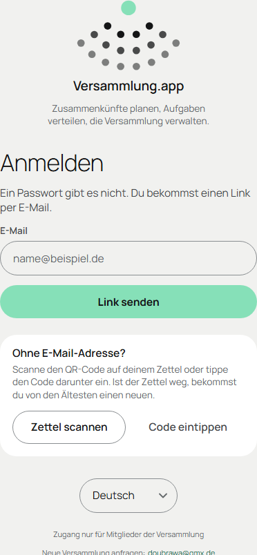

- **Mit dem Link aus der E‑Mail:** ein Tipp darauf, und du bist angemeldet.
  Ist er abgelaufen oder die E‑Mail weg, gib auf der Anmeldeseite deine
  Adresse ein und tippe auf **Link senden** – du bekommst einen neuen. Das geht,
  sobald die Ältesten dir einmal einen Link gegeben haben.
- **Mit dem Code aus der E‑Mail:** Unter dem Link steht ein Code. Hast du die
  App auf dem Home‑Bildschirm, öffne sie dort, tippe auf **Code eintippen** und
  gib ihn ein. Auf dem **iPhone** geht es nur so: Der Link öffnet immer Safari,
  nie die App vom Home‑Bildschirm – und dort wärst du nicht angemeldet (siehe
  [Abschnitt 8](#8-app-installieren--erinnerungen)). Jede neue E‑Mail bringt
  einen neuen Code; ein Zettel von früher gilt dann nicht mehr.
- **Mit dem Zettel:** Scanne den QR‑Code mit der Kamera deines Handys – oder
  tippe auf der Anmeldeseite unter **Ohne E‑Mail‑Adresse?** auf **Zettel
  scannen**. Geht das nicht, tippst du über **Code eintippen** den Code unter dem
  QR‑Code ein. Die App zeigt dir dann, wem der Code gehört; erst **Anmelden**
  meldet an. So merkst du es, wenn du den Zettel eines anderen erwischt hast.
- Ein Link gilt **30 Tage** und lässt sich mehrmals benutzen, etwa auf Handy und
  Tablet. Danach bleibt das Gerät angemeldet. Ist der Zettel weg, bekommst du
  von den Ältesten einen neuen – der alte gilt dann nicht mehr.
- Unten kannst du die **Sprache der App** wählen.
- Ganz unten steht die Adresse, an die man schreibt, wenn eine **neue
  Versammlung** die App nutzen möchte. Ein Tipp darauf öffnet eine fertige
  E‑Mail; die Adresse lässt sich aber auch abschreiben.

---

## 2. Startseite (Dashboard)

Nach der Anmeldung landest du auf deiner persönlichen Startseite. Sie fasst das
Wichtigste zusammen.

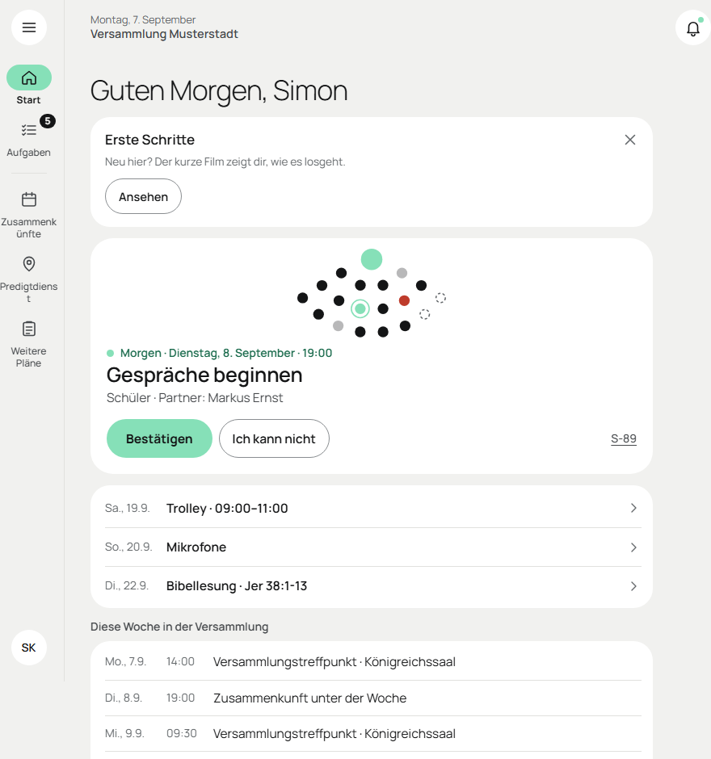

- **Deine nächste Aufgabe, groß** – wann („Morgen · Dienstag, 8. September ·
  19:00"), was, deine Rolle und bei Schulungsaufgaben dein Partner. Gleich
  darunter **Bestätigen** und **Ich kann nicht**, daneben das **S‑89**.
- **Der Saal** darüber zeigt, wie weit die Zusammenkunft besetzt ist: ein Punkt
  je Platz, **voll** heißt zugesagt, **blass** wartet noch auf Zusage, **rot**
  ist abgesagt, **gestrichelt** noch offen. Dein eigener Platz trägt einen Ring.
- Darunter **deine nächsten Aufgaben** danach, je eine Zeile; ein Tipp öffnet
  die Aufgabe. Nach dem Tag einsortiert stehen dort auch deine
  [Trolley-Termine](#trolleys) („Trolley · 09:00–11:00"); ein Tipp darauf
  führt zu den Trolleys. Die Liste zeigt höchstens drei Zeilen, alle zusammen
  stehen unter **Meine Aufgaben**. Die große Karte wird ein Trolley-Termin
  nie – er hat keine Zusage.
- **Diese Woche in der Versammlung** – die Zusammenkünfte und die Treffpunkte
  deiner Gruppe, die in dieser Woche noch kommen.

Neue **Mitteilungen** zeigt die **Glocke** oben rechts mit einem Punkt; ein
Tipp darauf öffnet sie (siehe Abschnitt 4).

Über das Menü an der Seite (auf dem Handy hinter dem Menüknopf oben links)
erreichst du **Start** und **Meine Aufgaben**, darunter unter **Versammlung** die
**Zusammenkünfte** und den **Predigtdienst**. Dein **Profil** öffnest du mit
einem Tipp auf deinen Namen ganz unten.

---

## 3. Das Programm ansehen

Unter **Zusammenkünfte** siehst du das vollständige Programm der Woche.
Mit den Pfeilen ‹ › blätterst du zwischen den Wochen. Unter der Woche steht,
was sie besonders macht – **Besuch des Kreisaufsehers**, **Gedächtnismahl**,
**Kongress** –, sonst in der laufenden Woche **Aktuelle Woche**, daneben das
Bibellesen der Woche. Auf dem Handy oder Tablet kannst du stattdessen auch
**seitwärts wischen** – nach links zur nächsten, nach rechts zur vorigen Woche.
Federt die Ansicht zurück, gibt es in der Richtung keine Woche mehr.

Darunter stehen die beiden Zusammenkünfte als Karten, je mit Tag, Datum und
Uhrzeit; die gewählte hat einen Rand. Fällt eine aus, ist ihr Tag
durchgestrichen, und im Programm steht der Grund. Im Programm hat jeder
Abschnitt seine Karte mit der Farbe des Arbeitshefts, das Lied steht rechts im
Kopf. Neben jedem Punkt steht seine Dauer, darunter die Eingeteilten, ihre
Aufgabe (Vorsitz, Gebet, Partner …) rechts am Rand wie das Lied – **dein
eigener Platz** heißt dort **„Du"**. Ab dem Tablet stehen die Namen neben dem
Punkt. **Am Computer** stehen beide Zusammenkünfte nebeneinander, jede mit
Datum und Uhrzeit, die Hilfsdienste beider Tage in einer gemeinsamen Tabelle;
die Karten zum Wählen fallen dort weg. Die Treffpunkte für den Predigtdienst
stehen im Menü unter **Predigtdienst**:

| Wo | Inhalt |
| --- | --- |
| **Zusammenkünfte** › Karte unter der Woche | Das Programm der Wochenmitte (Schätze aus Gottes Wort, Dienst, Unser Leben als Christ) mit allen Zuteilungen, darunter die Hilfsdienste. |
| **Zusammenkünfte** › Karte Wochenende | Öffentlicher Vortrag und Wachtturm‑Studium, darunter die Hilfsdienste. |
| **Predigtdienst** | Die „Treffpunkte" – wann und wo sich die Versammlung bzw. deine Gruppe zum Predigtdienst trifft, mit dem jeweiligen Leiter. |

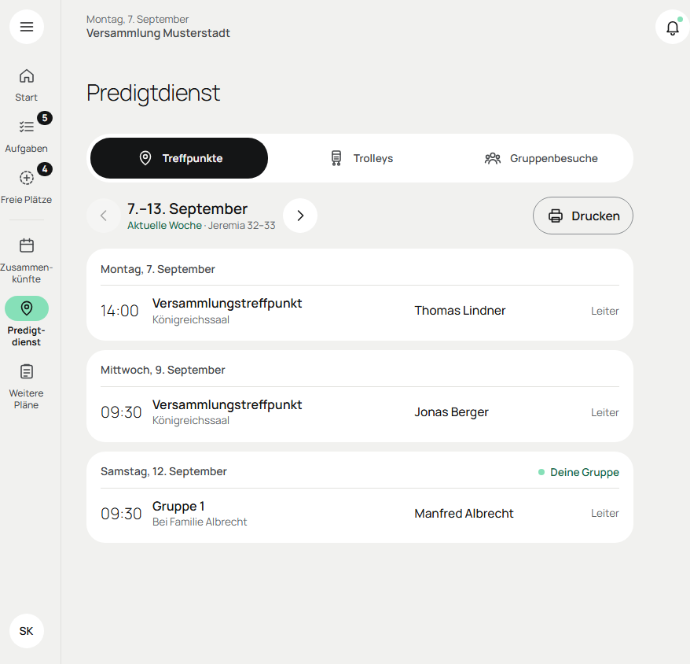

Oben im Predigtdienst wählst du den Bereich: **Treffpunkte** und – sobald es
sie gibt – **Gruppenbesuche** und **Trolleys**. Jeder Bereich hat ein großes
Feld mit seinem Zeichen, das gewählte ist kräftig hinterlegt; bei großer
Schrift stehen die Felder untereinander.

Bei den Treffpunkten siehst du **Versammlungstreffpunkte** (für alle) und die
**Gruppentreffpunkte** deiner Predigtdienstgruppe – je Tag eine Karte, darin die
Uhrzeit, der Ort und darunter der Leiter; leitest du selbst, steht dort
**„Du"**. Trifft sich deine Gruppe an einem Tag, steht an ihm **Deine Gruppe**.
Die Treffpunkte **anderer** Gruppen stehen nicht dabei; sie gehen dich nicht
an, und die Liste bliebe sonst voller Termine, zu denen niemand geht. Bist du
keiner Gruppe zugeordnet, siehst du die Versammlungstreffpunkte.

### Besuche des Dienstaufsehers

Der Dienstaufseher besucht reihum die Predigtdienstgruppen, an einem Wochenende
im Monat, und leitet dann ihre Treffpunkte. Sind Besuche geplant, steht im
Predigtdienst oben auch **Gruppenbesuche**. Darin stehen zuerst die Besuche bei
**deiner** Gruppe mit Treffpunkt und Besucher, darunter alle kommenden Besuche in
Kurzform – die deiner Gruppe hervorgehoben. In der Woche des Besuchs steht am
Treffpunkt deiner Gruppe **„Besuch des Dienstaufsehers"**.

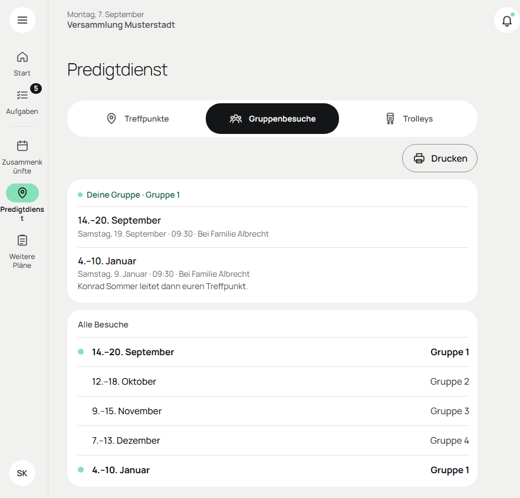

### Trolleys

Hat eure Versammlung Trolleys, steht im Predigtdienst für alle oben
**Trolleys** – das Feld mit dem Trolley-Zeichen; ein Tipp darauf öffnet den
Kalender. Beim Planen gibt es das Feld nicht. Mit dem Trolley steht man nur eine
Viertelstunde an einem Platz – was es braucht, ist ein Terminplan, in dem man
sich verabredet. Deshalb **plant niemand, und niemand sagt zu**: Wer mit dem
Trolley gehen darf, trägt sich selbst ein, mit einem Partner oder allein. Oben
steht: „Verabredet euch und tragt euch ein. So sehen alle, wann ein Trolley
unterwegs ist."

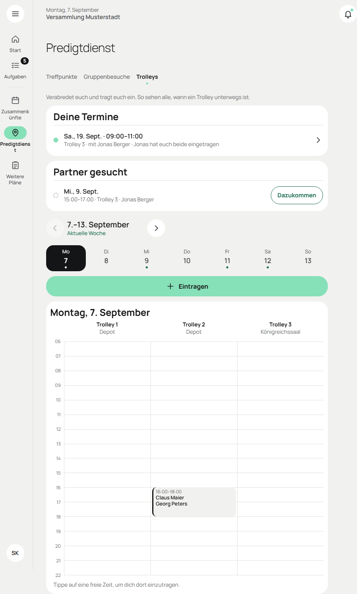

Darunter stehen, sobald es welche gibt, zwei Karten:

- **Deine Termine** – deine kommenden Termine: Tag und Zeit, darunter der
  Trolley und mit wem („mit Jonas Berger") oder **Partner gesucht**. Hat dein
  Partner euch beide eingetragen, steht dabei „Jonas hat euch beide
  eingetragen". Ein Tipp öffnet den Termin.
- **Partner gesucht** – wo andere allein stehen: Tag, Zeit, Trolley und Name.
  **Dazukommen** (nur mit dem Trolley-Recht, siehe unten) trägt dich sofort
  als Partner ein; wer gesucht hat, bekommt „Partner gefunden".

Darunter wählst du mit ‹ › die Woche, bis ein Vierteljahr voraus.

**Am Handy und am Tablet** wählst du im Streifen von Montag bis Sonntag den
Tag; ein Punkt unter einem Tag heißt, dass dort Termine stehen. Darunter steht
der **Tagesplan von 6 bis 22 Uhr**, eine Spalte je Trolley. **Tippe auf eine
freie Zeit, um dich dort einzutragen**: Das Blatt **Eintragen** öffnet mit Tag
und Trolley und schlägt zwei Stunden ab der angetippten halben Stunde vor,
höchstens bis zum nächsten Termin dieses Trolleys und bis 22 Uhr. Der Knopf
**Eintragen** über dem Tagesplan öffnet das Blatt ebenfalls, dann mit 10 bis
12 Uhr.

**Am Computer** steht die ganze Woche als Raster da: je Tag eine Zeile, je
Trolley eine Spalte, im Kopf jedes Trolleys, wo man ihn abholt („abholen:
Depot"). Rechts daneben steht das Formular **Eintragen** schon offen. **Klicke
in ein freies Feld, dann stehen Tag und Trolley rechts schon drin.**

In beiden Ansichten stehen Termine mit Partner gefüllt da, wer einen Partner
sucht, gestrichelt.

**Das Formular „Eintragen":**

- **Tag**, **Von** und **Bis** – „Zwischen 6 und 22 Uhr, in halben Stunden."
- **Trolley** – bis zu drei stehen nebeneinander zur Wahl, bei mehr eine Liste.
- **Mit wem** – **Mit Partner** (vorgewählt; unter **Partner** wählst du, wer
  mitkommt – zur Wahl steht, wer mit dem Trolley gehen darf) oder **Partner
  gesucht**.

Darunter steht, wer es erfährt: mit Partner „Jonas bekommt eine Mitteilung. Am
Vortag erinnert die App euch beide.", allein „Wer mitkommen möchte, sieht dich
unter „Partner gesucht". Am Vortag erinnert dich die App." Hat dein Partner
kein Konto in der App, erreicht ihn keine Mitteilung – sag es ihm dann selbst.

**Was im Weg steht, steht schon vor dem Absenden da**, und **Eintragen** bleibt
gesperrt: Der Tag ist vorbei; **Bis** liegt nicht nach **Von**; **der Trolley
ist zu dieser Zeit schon unterwegs** (ein Trolley, eine Zeit – wer um 11 Uhr
übernimmt, wo einer um 11 aufhört, stört niemanden); **du bist zu dieser Zeit
schon eingetragen** (niemand ist an zwei Orten zugleich); dasselbe für deinen
Partner. Gesperrt bleibt der Knopf auch, solange bei **Mit Partner** noch
niemand gewählt ist. War jemand anders im selben Moment schneller, sagt es die
App nach dem Absenden an derselben Stelle und lädt den neuen Stand.

**Ein Termin** (ein Tipp darauf) nennt den Trolley, Tag und Zeit, wo man ihn
abholt („abholen: Königreichssaal"), seinen Hinweis („Schlüssel im Fach neben
der Bühne") und wer dabei ist.

- **Austragen** fragt erst nach („Wirklich entfernen?"). Seid ihr zu zweit,
  bleibt der andere eingetragen, bekommt Bescheid und sucht dann wieder einen
  Partner. Warst du allein, ist der Termin weg.
- Sucht dort jemand einen Partner, steht im Termin **Dazukommen**.
- Was vorbei ist, steht nur noch da.

**Ohne Trolley-Recht** siehst du den Plan, kannst dich aber nicht eintragen.
Statt des Knopfs **Eintragen** (am Computer statt des Formulars) steht:
„Eintragen kann sich, wer mit dem Trolley gehen darf. Sprich dafür die
Ältesten an." Das Recht ist der Aufgabenbereich **Trolley** bei deiner Person;
ihn vergibt der Admin.

Deine Termine stehen auch auf der [Startseite](#2-startseite-dashboard) und
unter [Meine Aufgaben](#4-meine-aufgaben). **Mitteilungen** dazu bekommst du in
der Glocke und, wo aktiviert, als Push:

- **„Für den Trolley eingetragen"** – jemand hat dich als Partner eingetragen.
- **„Partner gefunden"** – jemand ist zu deinem Termin dazugekommen.
- **„Trolley-Termin abgesagt"** – dein Partner hat sich ausgetragen; du suchst
  jetzt wieder einen Partner.
- **„Trolley-Termin entfällt"** – der Admin hat den Trolley entfernt.
- **„Erinnerung: Trolley morgen"** – am Vortag an jeden, der eingetragen ist,
  mit dem Namen des anderen.

Ein Tipp auf eine dieser Mitteilungen führt zu **Meine Aufgaben**, wo deine
Trolley-Termine stehen.

### Weitere Pläne

Gibt es einen Plan, steht im Menü **Weitere Pläne**. Dort stehen
Ankündigungen – du musst nichts bestätigen und wirst nicht erinnert.

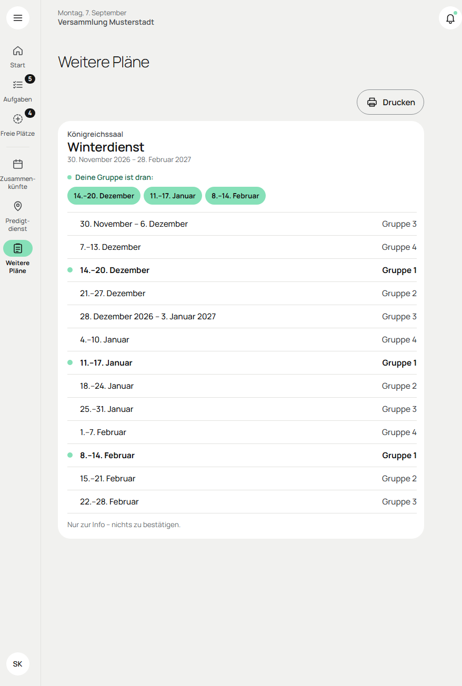

Ein Plan zeigt beim **Königreichssaal**, welche Predigtdienstgruppe in welcher
Woche – oder, wenn der Plan monatlich wechselt, in welchem Monat – mit der
Reinigung oder Instandhaltung dran ist. Oben unter „Deine Gruppe ist dran"
stehen die Wochen bzw. Monate deiner Gruppe, in der Liste darunter sind sie
hervorgehoben. Gibt es mehrere Pläne, wählst du oben einen aus; gedruckt wird
der, den du gerade siehst.

### Zusätzliche Klasse

Führt eure Versammlung eine **zusätzliche Klasse** durch, stehen bei den
Schülerteilen zwei Blöcke untereinander: **Hauptsaal** und **Zusätzliche
Klasse**. Betroffen sind die Bibellesung und die Teile unter „Uns im Dienst
verbessern"; die Teilnehmer gehen dafür nach dem Programmpunkt „Nach geistigen
Schätzen graben" in den zweiten Raum und kommen nach der letzten
Schulungsaufgabe zurück.

Bist **du** eingeteilt, siehst du am Block, in welchem Raum – und auf deinem
**S‑89‑Zettel** steht es ebenfalls.

### Kongress

In einer Woche mit **Kongress** fallen alle Zusammenkünfte aus. Statt des
Programms steht das dort, und zwei Wege führen weiter: zu den **Treffpunkten
dieser Woche** und zur **nächsten Zusammenkunft**, die stattfindet.

### Ausdrucken

Neben dem Termin jeder Zusammenkunft und über den Treffpunkten steht das
**Drucker**‑Zeichen, ab dem Tablet der Knopf **Drucken** rechts neben der Woche.
Er öffnet ein Blatt: **Diese Woche** ist vorgewählt – beide Zusammenkünfte auf
einem Blatt, mit den Hilfsdiensten –, oder du wählst den **ganzen Monat**,
knapp, Woche für Woche. Erst **Drucken** druckt. Gedruckt wird ein eigener
Bogen auf A4, nicht der Bildschirm; freie Plätze stehen gepunktet da. Wo bei
dir **„Du"** steht, druckt der Bogen deinen Namen; der Aushang gilt allen. Auch
die **Gruppenbesuche**, die **Trolleys** und die **Weiteren Pläne** haben einen
**Drucken**‑Knopf. Nötig ist das nicht: Deine eigenen Aufgaben stehen unter
**Meine Aufgaben**, und das Programm ist hier immer aktuell.

---

## 4. Meine Aufgaben

Unter **Meine Aufgaben** siehst du alle Zuteilungen, die dich betreffen, in
zeitlicher Reihenfolge. **Vergangenes fällt heraus** – ab dem Tag nach der
Zusammenkunft. Es wird dir also nicht mehr zum Bestätigen vorgelegt und zählt
auf der Startseite nicht mehr mit.

### Wie du von einer Zuteilung erfährst

**Wenn der Koordinator die Woche freigibt**, bekommst du eine Mitteilung
„Neue Zuteilung" mit allen deinen Aufgaben dieser Woche auf einmal – in der App
und, wenn du Push aktiviert hast, auch als Benachrichtigung auf dem Gerät. Beim
nächsten Öffnen der App legt sie dir die offenen Zuteilungen zum Bestätigen vor:
je Aufgabe **Bestätigen** oder **Ich kann nicht**, unten **Alle bestätigen**.
Mit **Später** legst du das Blatt weg; beim nächsten Öffnen liegt es wieder da.

Weitere Nachrichten können dich erreichen:

- **„Erinnerung: Zuteilung bestätigen"** – solange du nicht bestätigt hast,
  einige Tage vor der Zusammenkunft und noch einmal kurz davor; der Planer kann
  dich auch selbst erinnern. Mehr als eine Erinnerung am Tag bekommst du nicht.
  Betrifft sie nur eine Aufgabe, kannst du direkt in der Mitteilung bestätigen.
- **„Zuteilung zurückgezogen"** – der Koordinator hat dir eine Aufgabe wieder
  genommen, von der du **schon wusstest** – du hattest sie bestätigt, oder sie
  war dir mitgeteilt worden. Dann brauchst du dich nicht weiter vorzubereiten.
- **„Für den Trolley eingetragen"**, **„Partner gefunden"** und die übrigen
  Mitteilungen zu deinen Trolley-Terminen (siehe [Trolleys](#trolleys)).

### Die Mitteilungen

Die **Glocke** oben rechts öffnet die **Mitteilungen**; am Computer stehen sie
im Menü. Oben steht **Neu**, darunter **Früher** – was du schon gelesen hast.
Jede Mitteilung steht höchstens zwei Zeilen lang (am Computer zeigt der
Mauszeiger den ganzen Text).

- **Gleich hier erledigen:** Wartet eine neue Zuteilung noch auf deine Zusage,
  stehen **Bestätigen** und **Ich kann nicht** direkt darunter; bei „Ersatz
  gesucht" steht **Übernehmen**, solange noch niemand eingesprungen ist.
- **Ein Tipp auf die Mitteilung führt dorthin, wo sie herkommt:** zu deiner
  Aufgabe, gleich mit Bestätigen und Absagen; bei „Ersatz gesucht" zum
  Einspringen; ohne bestimmte Aufgabe zu **Meine Aufgaben**.
- Was du angetippt, bestätigt oder übernommen hast, gilt als gelesen und steht
  danach unter **Früher**. **Alle gelesen** (am Handy oben rechts) räumt „Neu"
  auf einmal ab.
- Solange Benachrichtigungen auf diesem Gerät aus sind, steht ganz oben die
  Karte **Keine Zuteilung verpassen** mit **Aktivieren** (siehe
  [Abschnitt 8](#8-app-installieren--erinnerungen)). Brauchst du sie nicht,
  blendet das **✕** sie auf diesem Gerät für immer aus; einschalten kannst du
  Benachrichtigungen weiterhin im **Profil**.

> Solange der Koordinator noch plant, erfährst du nichts – auch wenn dein Name
> im Programm schon steht. Das ist Absicht: Bis die Woche steht, wird oft noch
> umsortiert.

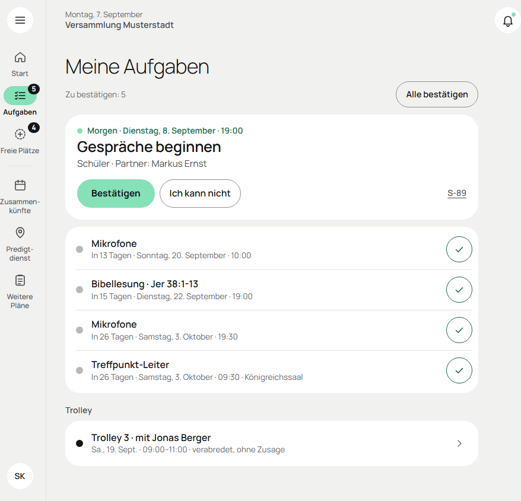

Oben steht, wie viele Aufgaben noch auf deine Zusage warten. Die nächste steht
groß da, wie auf der Startseite; die übrigen je eine Zeile mit einem Punkt für
ihren Stand (blass: wartet, voll: zugesagt, rot: abgesagt):

- **Der Haken** rechts bestätigt die Aufgabe – dein Koordinator sieht, dass du
  sie übernimmst.
- **Alle bestätigen** sagt alles Offene auf einmal zu.
- **Antippen** öffnet die Aufgabe. Dort kannst du sie auch **absagen** – und
  eine Absage später wieder zurücknehmen.
- **S‑89** – siehe unten.

Unter den Aufgaben stehen deine **Trolley-Termine** im eigenen Abschnitt
**Trolley**: je Termin „Trolley 3 · mit Jonas Berger" (oder „Trolley 3 ·
Partner gesucht"), darunter „Sa., 19. Sept. · 09:00–11:00 · verabredet, ohne
Zusage". Einen Haken gibt es dort nicht – wer sich eingetragen hat, hat sich
verabredet. Ein Tipp führt zu den [Trolleys](#trolleys).

> **Tipp:** Bestätige zeitnah. Dein Koordinator sieht offene Bestätigungen und
> weiß dann, dass alles steht.

### Wenn du nicht kannst

Wähle **„Ich kann nicht"**. Es öffnet sich ein Blatt „Du kannst nicht?", das
zeigt, wie es danach weitergeht:

- Bei einem **Hilfsdienst** (Mikrofone, Ton, Ordner …) sucht die App sofort
  selbst einen Ersatz und benachrichtigt alle, die für diesen Dienst
  eingetragen und an dem Tag nicht abwesend sind. Du musst niemanden
  persönlich anrufen.
- Bei **Programmpunkten** und Treffpunkten erfährt es dein Koordinator sofort
  und teilt neu zu.

Freiwillig kannst du zwei Dinge mitgeben: eine **Nachricht an den Planer** (sie
steht in seiner Mitteilung, etwa „bin an dem Tag verreist") und **den Tag als
abwesend** – dann wirst du an diesem Tag gar nicht erst wieder eingeteilt. Der
Schalter dafür steht aus; ist der Tag schon eingetragen, fehlt er. Erst
**Absagen** sendet ab; **Abbrechen** legt das Blatt weg, ohne etwas zu ändern.

Hast du dich vertan, öffne die Aufgabe erneut und wähle **„Doch bestätigen"**.
Bei einem Hilfsdienst endet damit auch die Ersatzsuche: Die Mitteilung
„Ersatz gesucht" verschwindet bei den anderen wieder.

### Einspringen für jemand anderen

Sagt jemand einen Hilfsdienst ab, den **du** übernehmen könntest, bekommst du
eine Mitteilung („Ersatz gesucht") und – falls aktiviert – eine Push-Nachricht.
Die Anfrage geht **nur an die, die für diesen Dienst freigegeben und an dem Tag
nicht abwesend sind** – du bekommst also nichts angeboten, was nicht zu dir
passt.

Du bekommst es auf drei Wegen zu sehen, und dafür musst du nichts suchen:

- **Über die Push-Nachricht oder die Mitteilungen** – dort übernimmst du
  gleich mit **Übernehmen**; ein Tipp auf die Mitteilung selbst öffnet **Meine
  Aufgaben** und springt direkt zum Bereich **Einspringen**, statt oben auf der
  Seite zu landen.
- **Beim Öffnen der App** – dasselbe Blatt, das dich an unbestätigte
  Zuteilungen erinnert, zeigt darunter den Bereich **Einspringen**. Mit
  **Später** legst du das Blatt weg: Einspringen kannst du, müssen tust du es
  nicht.
- Unter **Meine Aufgaben** – dort steht der Bereich **Einspringen** dauerhaft,
  solange die Anfrage offen ist. Eine eigene Seite dafür gibt es bewusst nicht:
  Sie wäre fast immer leer.

Beide zeigen dasselbe: den gesuchten Dienst, den Termin und den Namen dessen,
der abgesagt hat. Hast du an dem Tag **schon etwas anderes**, steht es rot
darunter („An diesem Tag schon: …") – du siehst es also, bevor du zusagst. Ein
Tipp auf **Übernehmen** trägt dich ein und bestätigt die Aufgabe gleich mit.

Es gilt: **wer zuerst tippt.** War jemand schneller, verschwindet der Eintrag –
dann ist der Dienst schon besetzt.

### Freie Plätze übernehmen

Ist im Programm ein Platz **noch gar nicht besetzt**, den du übernehmen
könntest, steht er unter **Meine Aufgaben** im Bereich **Freie Plätze** – aber
erst, wenn der Koordinator den Plan der Woche gesendet hat. Vorher plant er
noch, und ein leerer Platz hieße nichts.

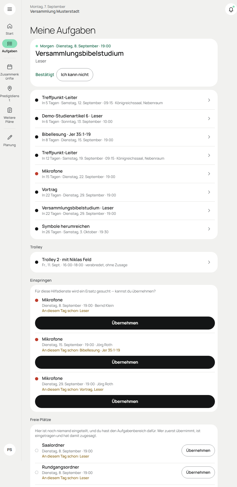

Angeboten wird nur, wofür du einen **Aufgabenbereich** hast, was noch kommt und
wo du an dem Tag nicht abwesend bist. **Nicht** dabei sind Schulungsaufgaben
(die teilt der Koordinator mit Lektion und Partner zu), der öffentliche Vortrag
und die Reinigung.

Wie beim Einspringen steht vorher darunter, was du an dem Tag schon hast. Ein
Tipp auf **Übernehmen** trägt dich ein und bestätigt gleich mit. Auch hier gilt:
**wer zuerst tippt.** War jemand schneller, lädt die App neu, und der Platz ist
weg.

### Das S‑89-Formular

Bei Schulungsaufgaben (Bibellesung, Gespräche beginnen, Interesse fördern …)
steht bei der Aufgabe **S‑89 anzeigen**. Das öffnet die Aufgabenzuteilung, wie
sie sonst auf Papier ausgeteilt wird:

- **Name** und ggf. **Gesprächspartner/in**
- **Datum** der Zusammenkunft
- **Aufgabe** und **Schulungspunkt**
- **Durchzuführen im** – Hauptsaal oder Zusätzliche Klasse

Quelle und Schulungspunkt stehen im Arbeitsheft; das Formular nennt sie, soweit
sie beim Import mitgekommen sind. Du kannst es ansehen und deinem Gehilfen
zeigen – ausdrucken musst du es nicht. Ab dem Tablet steht darunter **Diesen
Zettel drucken**, falls du es doch auf Papier willst.

---

## 5. Abwesenheiten eintragen

Im **Profil** findest du die Karte **Abwesenheiten**. Trage dort ein, wann du
z. B. im Urlaub oder verhindert bist – dann wirst du in dieser Zeit nicht
eingeteilt.

1. Auf **Abwesenheit eintragen** tippen. Es öffnet sich ein Kalender.
2. Den ersten Tag antippen, dann den letzten. Ein einzelner Tag ist ein Tipp.
   Oben stehen **Von** und **Bis**; das hervorgehobene Ende setzt der nächste
   Tipp. Ein Tipp vor „Von" beginnt den Zeitraum neu.
3. Optional einen **Grund** angeben (z. B. „Urlaub").
4. Auf **Abwesenheit eintragen** tippen.

Deine Zeiträume, die anstehen oder gerade laufen, stehen in der Karte und
lassen sich mit dem ✕ wieder entfernen. Der erste Tipp fragt „Wirklich
löschen?", erst der zweite entfernt den Eintrag; ein Tipp daneben bricht ab.
Was vorbei ist, steht nicht mehr da. Acht Wochen nach seinem Ende löscht die
App einen Zeitraum samt Grund von selbst; danach braucht ihn niemand mehr.

Dort stehen auch Zeiträume, die **nicht du** eingetragen hast: Ein Admin kann
sie für dich erfassen (etwa wenn du angerufen hast), und beim Umstieg von einem
anderen Programm sind sie mit übernommen worden. Es ist dieselbe Liste – du
kannst sie genauso entfernen. Umgekehrt siehst du hier **nur deine eigenen**;
die Abwesenheiten anderer gehen dich nichts an.

Sagst du eine Aufgabe ab, kannst du den Tag dabei gleich als abwesend eintragen
(siehe [Wenn du nicht kannst](#wenn-du-nicht-kannst)).

**Es zählt der Tag, nicht die Woche.** Bist du nur übers Wochenende weg, bleibst
du für die Zusammenkunft unter der Woche eingeplant – und umgekehrt. Auch bei den
Treffpunkten wird der jeweilige Wochentag geprüft. Der Planer sieht deinen
Eintrag beim Zuteilen als Hinweis „abwesend", und die automatische Zuteilung
übergeht dich in diesem Zeitraum.

---

## 6. Bedienung auf Handy und Tablet

Neben dem Antippen gibt es ein paar Gesten. Sie sind immer nur eine Abkürzung –
alles geht auch weiterhin über Knöpfe und Pfeile.

- **Seitwärts wischen** – blättert bei den **Zusammenkünften**, im
  **Predigtdienst** und beim **Planen** eine Woche vor oder zurück.
- **Zurück** (Zurück‑Taste oder Zurück‑Geste) – bleibt in der App: Es schließt
  zuerst ein geöffnetes Fenster oder das Menü, dann eine geöffnete Ansicht
  (etwa einen Plan), und führt sonst zur **Startseite**. Erst auf der
  Startseite verlässt Zurück die App. Auf den Mitteilungen führt auch der Pfeil
  oben links zur Startseite.
- **Nach unten wischen** – schließt ein von unten eingeblendetes Fenster. Der
  kurze Strich am oberen Rand zeigt, dass es sich ziehen lässt.

Auf einem Tablet im Hochformat steht links eine **schmale Leiste** mit Zeichen
und kurzen Namen; der Menüknopf darin klappt das ganze Menü aus. Im Querformat
und am Computer steht das Menü ausgeklappt links, dort auch die
**Mitteilungen**.

Auf dem Handy und am Tablet steht oben in der Kopfzeile der **heutige Tag** und
deine **Versammlung**, rechts die **Glocke** für die Mitteilungen – ein Punkt
daran heißt: Es gibt Neues. Ein sehr langer Versammlungsname wird dort mit „…“
gekürzt; ganz steht er im Menü. Auf den Mitteilungen selbst steht am Handy
statt der Kopfzeile der Pfeil zurück und **Alle gelesen**.

## 7. Profil: Darstellung, Schriftgröße & Sprache

Das **Profil** öffnest du über deinen Namen unten im Menü. Oben stehen deine
Initialen, dein Name, deine Rolle und deine Gruppe; darunter stellst du
persönliche Vorlieben ein, trägst Abwesenheiten ein (Abschnitt 5) und meldest
dich ab. Admins finden am Handy hier auch **Personen** und **Einstellungen**.

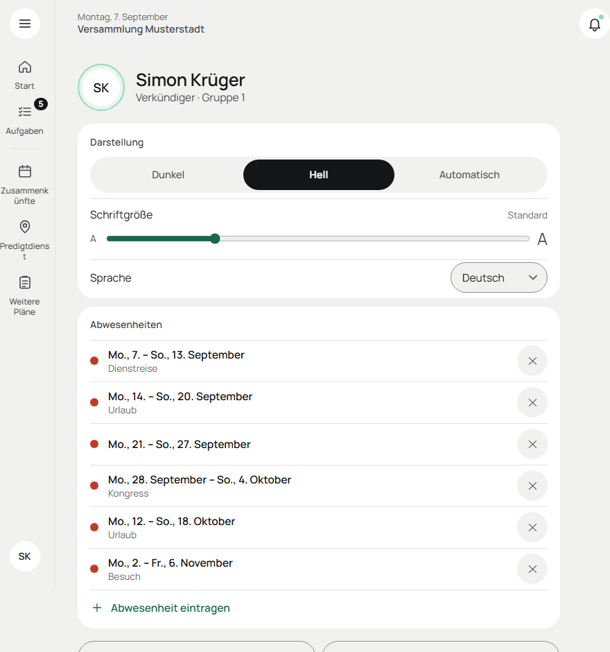

- **Darstellung** – **Dunkel**, **Hell** oder **Automatisch**. „Automatisch"
  ist voreingestellt und folgt deinem Gerät: Schaltet das Handy abends auf
  dunkel, schaltet die App mit. Die Einstellung gilt nur für dein Gerät.
- **Schriftgröße** – ein Regler von **Klein** bis **Sehr groß**. Standard ist die
  bisherige Größe; wenn dir der Text zu klein ist, schiebe ihn nach rechts. Die
  Änderung wirkt sofort in der ganzen App und gilt nur für dein Gerät.
- **Sprache** – die Anzeigesprache der App, in 12 Sprachen. Sie gilt nur für
  dich: Deine Versammlung kann deutsch planen, während du alles auf Englisch
  liest.
  - **Das Programm wird mit übersetzt.** Die Titel der Programmpunkte, die
    Bibelbücher und die Rollen erscheinen in deiner Sprache. Hat dein Planer
    die Woche zusätzlich in deiner Sprache geholt, kommen die Texte wörtlich
    von jw.org; sonst übersetzt die App, was sie belegen kann, und lässt den
    Rest stehen.
  - **Auch die Nachrichten.** Eine Push-Erinnerung entsteht in dem Moment, in
    dem sie verschickt wird – in der Sprache, die auf **diesem Gerät**
    eingestellt war. Hast du die App auf zwei Geräten mit verschiedenen
    Sprachen, bekommt jedes seine eigene. Die Mitteilungen in der App folgen
    dagegen immer der Sprache, die du gerade eingestellt hast.
  - **Rechts nach links.** Bei Arabisch, Hebräisch, Persisch und Urdu läuft die
    ganze Oberfläche von rechts nach links – auch das Blättern zwischen den
    Wochen: Dort liegt die **vorige** Woche rechts.
  - **Die E‑Mail mit dem Link ist die Ausnahme**: Die erste kommt in der
    Sprache der Versammlung, ebenso der Zettel – wer sie bekommt, hat noch
    keine Sprache eingestellt. Einen neuen Link, den du auf der Anmeldeseite
    anforderst, schreibt die App in der Sprache, die du dort gewählt hast.
- **Push‑Mitteilungen** – Erinnerungen an anstehende Aufgaben ein‑ oder
  ausschalten (siehe [Abschnitt 8](#8-app-installieren--erinnerungen)).
- **Abmelden** – meldet dich auf diesem Gerät ab. Der erste Tipp fragt
  „Wirklich abmelden?", erst der zweite meldet ab.

---

## 8. App installieren & Erinnerungen

Der Versammlung.app ist eine **Web‑App (PWA)** – du brauchst nichts aus einem
Store zu laden. Du öffnest die Adresse im Browser und legst sie dir als App ab.

### Android (Chrome)

1. Die App‑Adresse in **Chrome** öffnen.
2. Im **⋮**‑Menü **App installieren** antippen. Je nach Chrome‑Version heißt der
   Eintrag *Installieren* oder – weiter unten – *Zum Startbildschirm hinzufügen*.
3. Bestätigen. Die App liegt danach wie jede andere im App‑Menü und startet ohne
   Browserleiste.

> Chrome zeigt **von selbst kein Hinweisbanner** mehr an. Wenn beim Öffnen nichts
> erscheint, ist nichts kaputt – der Eintrag steckt nur im ⋮‑Menü.

### iPhone / iPad (Safari)

1. Die App‑Adresse in **Safari** öffnen. In Chrome auf dem iPhone fehlt der
   nötige Eintrag meist – Safari ist hier der zuverlässige Weg.
2. Das **Teilen**‑Symbol antippen (Quadrat mit Pfeil nach oben) und nach unten
   scrollen.
3. **Zum Home‑Bildschirm** → **Hinzufügen**.

### Wenn kein Installieren angeboten wird

- Hast du den Link **aus WhatsApp, Telegram oder einer E‑Mail** geöffnet? Diese
  Apps zeigen die Seite in einem eingebauten Browser, der nicht installieren kann
  – erkennbar an der fehlenden Adresszeile. Über das Menü der App
  **In Chrome öffnen** bzw. **In Safari öffnen** wählen und es dort erneut
  versuchen.
- Möglicherweise ist die App **schon installiert** – dann verschwindet der
  Eintrag aus dem Menü.

### Danach einmal mit Internet anmelden

Melde dich nach dem Installieren einmal **mit Internetverbindung** an und sieh dir
Programm und Aufgaben an. Auf dem **iPhone** meldest du dich **in der App vom
Home‑Bildschirm** an, nicht vorher in Safari: Die App hat dort einen eigenen
Speicher, eine Anmeldung in Safari gilt in ihr nicht. Öffne sie, tippe auf
**Code eintippen** und gib den Code aus der E‑Mail oder vom Zettel ein – der
Link aus der E‑Mail öffnet nur Safari. Erst dadurch legt die App den Stand ab, den sie dir
später [ohne Internet](#9-ohne-internet-offline) zeigen kann. Direkt nach dem
Installieren ist offline noch nichts vorhanden.

### Erinnerungen (Push‑Benachrichtigungen)

Wo dein Gerät es unterstützt, kannst du Erinnerungen an anstehende Aufgaben als
Push‑Nachricht erhalten – über **Aktivieren** auf der Karte oben in den
**Mitteilungen** oder den Schalter **Push‑Mitteilungen** unter **Profil**.
Beides erscheint nur, wenn dein Browser Push unterstützt; hat er die Erlaubnis
schon einmal verweigert, gibst du sie in seinen Einstellungen wieder frei. Auf dem iPhone
funktioniert das
**nur aus der installierten App** – im normalen Safari‑Tab kommen keine
Benachrichtigungen an. **Erinnerungen kommen ausschließlich als Push‑Nachricht –
nie per E‑Mail.**

Ohne Push verpasst du nichts: Jede Nachricht steht auch in der App unter den
**Mitteilungen** (Glocke oben rechts), und offene Zuteilungen legt dir die App
beim Öffnen ohnehin vor. Push spart dir nur das Nachsehen.

---

## 9. Ohne Internet (offline)

Im Saal ist der Empfang manchmal schlecht. Die App startet deshalb auch ohne
Internet und zeigt dir den **letzten Stand**, den sie beim letzten Mal geladen
hat. Zeigt dein Handy Empfang an, kommt aber nichts durch, dauert das ein paar
Sekunden. Oben erscheint dann ein Hinweisstreifen mit dem Zeitpunkt:

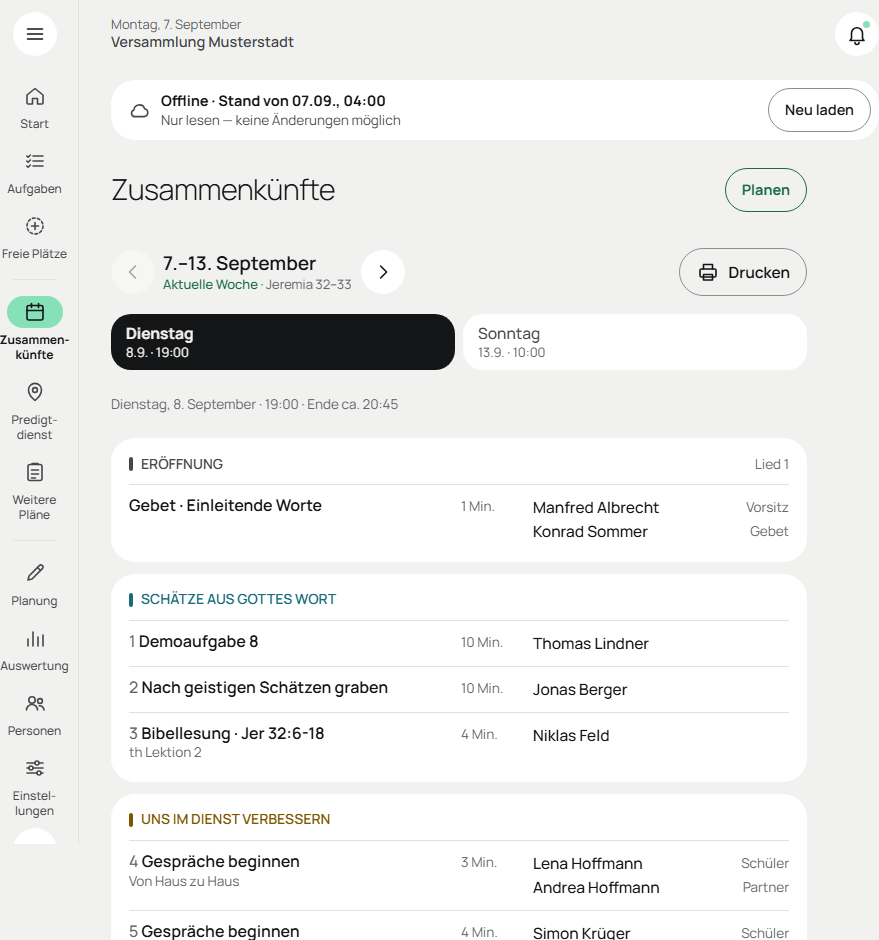

- **Lesen geht:** Programm, Treffpunkte, deine Aufgaben und Abwesenheiten sind
  wie zuletzt geladen sichtbar.
- **Ändern geht nicht:** Bestätigen, Abwesenheiten eintragen oder Ähnliches ist
  gesperrt – sonst würde deine Eingabe verloren gehen, weil sie niemand
  empfangen kann. Beim Antippen erscheint ein kurzer Hinweis.
- **„Neu laden"** holt den aktuellen Stand, sobald du wieder Netz hast.

Zwei Dinge, die du wissen solltest:

- Der angezeigte Stand kann **veraltet** sein. Steht im Streifen z. B. „Stand von
  gestern", kann sich eine Zuteilung inzwischen geändert haben.
- Warst du **lange** nicht mehr online, kann es passieren, dass du dich neu
  anmelden musst – mit deinem Link oder Zettel (siehe [Abschnitt 1](#1-anmelden)).
  Das Anmelden selbst braucht Internet.

---

## 10. Wenn du Gruppenaufseher bist

Bist du **Aufseher oder Gehilfe** einer Predigtdienstgruppe, kannst du die
**Treffpunkte deiner Gruppe** selbst planen und senden — ohne Admin zu sein. Der
Admin trägt das bei der Gruppe ein; danach steht im **Predigtdienst** neben dem
Titel **Planen**, und im Menü unter **Planen und verwalten** die **Planung**.
Beim Planen gibt es zwei Reiter:

| Reiter | Was du dort siehst |
| --- | --- |
| **Treffpunkte** | Ausschließlich die Treffpunkte **deiner** Gruppe, Woche für Woche: **Uhrzeit** und **Ort** ändern, einen Treffpunkt für diese Woche **entfernen** oder einen zusätzlichen **ergänzen**, Leiter eintragen. Am Handy unten in der Leiste: **Automatisch** (zuteilen oder leeren, beides wirkt nur auf deine Gruppe) und **Plan senden** — es benachrichtigt die Leiter deiner Gruppe, die davon noch nichts wissen. |
| **Grundplan** | Nur den **Grundplan deiner Gruppe** — die Regel, nach der ihr euch regelmäßig trefft: Wochentag, Uhrzeit, Ort und ob sie jede Woche gilt oder z. B. jeden ersten im Monat. |

Die Zusammenkünfte siehst du nur an. **Fertig** (am Handy auch das Kreuz oben)
führt vom Planen zurück zum Ansehen.

Die **Besuche des Dienstaufsehers** planen Admins und Planer; du siehst sie beim
Ansehen unter **Gruppenbesuche** und kannst deine Gruppe darauf einstellen. In
der Besuchswoche leitet der Besucher euren Treffpunkt — er steht dann dort als
Leiter, und du musst ihn nicht selbst eintragen.

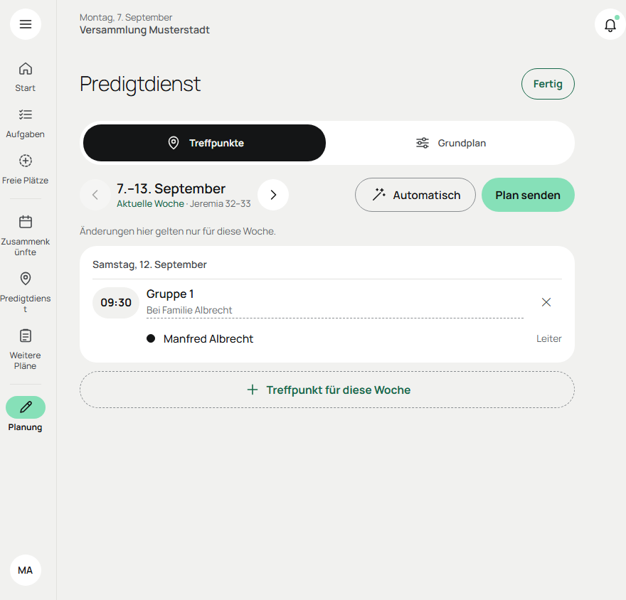

Der **Punkt vor dem Namen** sagt dir, woran du bist: voll heißt
**bestätigt**, blass **wartet noch auf Bestätigung**, rot **stimmt etwas
nicht** — rechts daneben steht, was: abgesagt, abwesend oder an diesem Tag
schon eingeteilt. Teilst du einen Treffpunkt neu zu, steht er wieder blass da —
die Zusage gehört dem, der sie gegeben hat.

Die **Personen** bleiben dem Koordinator vorbehalten, und die Zuteilungen der
Zusammenkünfte ebenso — daran änderst du nichts. Alles Übrige siehst du wie jeder
andere Verkündiger: eigene Aufgaben, Zusammenkünfte, Abwesenheiten, Profil.

> **Wer sieht eure Gruppentreffpunkte?** Nur die Verkündiger deiner Gruppe — und
> du. Versammlungstreffpunkte sehen alle.

Wie das Planen der Treffpunkte im Einzelnen funktioniert, steht ausführlich im
Handbuch für Planer unter [Treffpunkte planen](planer.md#5-treffpunkte-planen).

---

*Fragen zur Bedienung beantwortet dein Versammlungskoordinator.*
